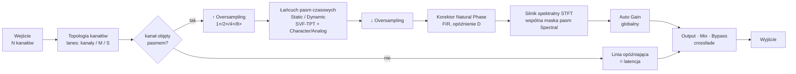
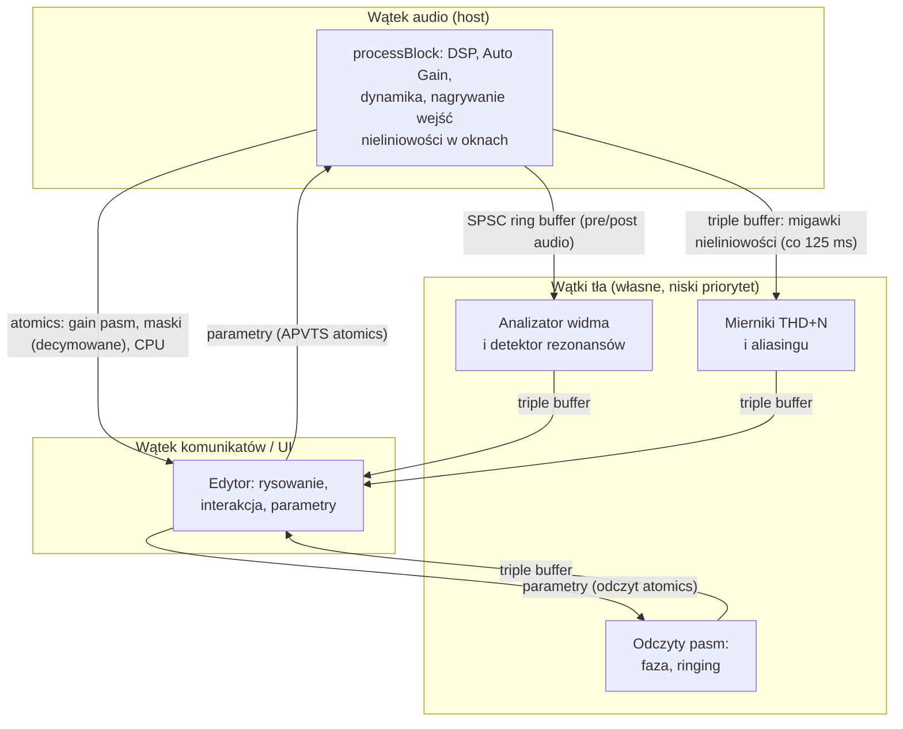

# Architektura — Sam Spectral Control

Status: **M0 (propozycja do akceptacji)**. Dokument realizuje ARC-1…ARC-6 z [PROMPT.md](../PROMPT.md). Uzasadnienia decyzji są w [ADR](decisions/), a podstawy merytoryczne w [research](research/).

## 1. Zasady nadrzędne

1. **Determinizm audio.** Wszystko, co wpływa na dźwięk (DSP, Auto Gain, dynamika), liczy się w wątku audio, deterministycznie. Wątki tła produkują wyłącznie dane do wyświetlania. Dzięki temu render offline brzmi tak samo jak odtwarzanie (NFR-3).
2. **Real-time safety.** W wątku audio nie ma alokacji, blokad, I/O ani logowania; wszystko jest prealokowane w `prepareToPlay` dla maksymalnej konfiguracji (32 kanały, 24 pasma, 8× OS). Weryfikacja: RealtimeSanitizer (Clang 20+) w CI na Linuksie.
3. **Rdzeń bez GUI.** Kod DSP (`src/core`) nie zależy od GUI ani od `AudioProcessor`; może używać tylko `juce_core`, `juce_audio_basics` i `juce_dsp`. Jest w całości testowalny w izolacji (ARC-5).
4. **Jedno źródło prawdy dla odczytów.** Odczyty (faza, ringing, THD/aliasing) liczy ten sam kod DSP, który przetwarza audio.

## 2. Tor sygnału (ARC-1)



Uwagi:
- **Lookahead**: tor główny jest opóźniony o `Max Lookahead` (linie opóźniające w łańcuchu), detekcja pasm widzi sygnał wcześniej (§6 research).
- **Korektor Natural Phase** działa na bazowym fs po decymacji: jeden FIR na kanał (albo na składową M/S pary) koryguje sumaryczny błąd fazy całego łańcucha, więc opóźnienie D występuje tylko raz. Korekcja jest dokładna, gdy pasma działające na danej parze są „diagonalne” w jednej bazie — wszystkie w {All, Left, Right} (korekcja per kanał) albo wszystkie w {All, Mid, Side} (korekcja w M/S). Przy mieszaniu pasm L/R i M/S na tej samej parze korekcja jest przybliżona, a UI to sygnalizuje (ADR-0005).
- **Silnik STFT** przetwarza tylko lane, na których działa co najmniej jedno pasmo Spectral; pozostałe lane omijają go z wyrównaniem opóźnienia.
- **Kanały nieobjęte pasmami** omijają cały tor (CH-6).

### Budżet latencji

| Składnik | Kiedy | Wartość (48 kHz) |
|---|---|---|
| Oversampling | OS > 1× | zależnie od typu filtra (IIR: kilka próbek; FIR: dziesiątki); przy osobnym ustawieniu renderu offline (OS-4) — większa z dwóch latencji, krótszy tor dopełniony opóźnieniem |
| Natural Phase | tryb Natural Phase (lub Analog Feel High/Max) | D = 16 / 32 / 64 / 128 próbek (Eco…Max) |
| Max Lookahead | > 0 | 0–20 ms |
| Silnik STFT | istnieje ≥ 1 pasmo w trybie Spectral | ≈ N_fft (2048–8192 próbek) |

Latencja całkowita jest sumą składników i zmienia się wyłącznie po jawnej zmianie konfiguracji przez użytkownika (ADR-0011). Parametr Mode pasma nie jest automatyzowalny, bo zmiana Static/Dynamic ↔ Spectral może włączyć silnik STFT.

## 3. Model kanałów i pasm

- `ChannelTopology` (z `AudioChannelSet`): kanały z typem semantycznym, grupy, pary symetryczne, single — zob. [research §4](research/04-kanaly-surround-atmos.md).
- `BandTarget { SpeakerMask speakers; Component component; }` zapisany semantycznie (preset przenośny między układami).
- **Lane** = kanał albo składowa M/S pary. Każde pasmo ma stan filtrów per lane; M/S kodowane lokalnie w paśmie.
- Pasma przetwarzane szeregowo w kolejności indeksów. Dla pasm liniowych kolejność nie ma wpływu na wynik; dla nieliniowych (Character, Analog) jest udokumentowana w manualu.

## 4. Moduły i struktura repozytorium

```
CMakeLists.txt, CMakePresets.json
cmake/                 – ostrzeżenia, sanitizery, wersjonowanie
external/JUCE          – submoduł git, tag 9.0.3 (ADR-0001)
external/pffft         – submoduł git (ADR-0013)
src/core/              – rdzeń DSP (bez GUI)
  util/                – SPSC FIFO, triple buffer, denormale, wygładzanie, matematyka
  filters/             – projekty dopasowane, Butterworth, półki Holters–Zölzer,
                         SVF-TPT, mapowanie biquad→SVF, tabele gainów
  dynamics/            – detektory, komputer wzmocnienia, wygładzanie, linkowanie
  spectral/            – STFT/WOLA, narzędzia ERB, obwiednia, maski
  phase/               – korektor Natural Phase, splot partycjonowany
  nonlinear/           – waveshapery z ADAA, modele Analog N/P/S
  loudness/            – ISO 226, model sonów, K-weighting BS.1770, kontroler Auto Gain
  analysis/            – analizator widma, detektor rezonansów, analiza pasm, mierniki
  engine/              – ChannelTopology, lanes, BandProcessor, EqEngine, LatencyManager
src/plugin/            – AudioProcessor, układ parametrów (APVTS), stan, presety, telemetria
src/ui/                – edytor: EqDisplay, węzły pasm, BandPanel, menu, SpeakerPanel,
                         mierniki, motyw
tests/                 – Catch2 v3: testy jednostkowe rdzenia, integracyjne procesora
tools/                 – ssc-measure (render + metryki offline), ssc-bench (benchmarki)
installer/macos        – pkgbuild/productbuild, notaryzacja
installer/windows      – Inno Setup
.github/workflows/     – ci.yml (build + testy + pluginval), release.yml (podpisy, instalatory)
docs/                  – research, ADR, architektura, testy, pomiary, manual
```

## 5. Parametry i stan

- `AudioProcessorValueTreeState` z jawnym `ParameterLayout`. ID parametrów stabilne (`b07_freq`, `b07_mode`, `global_phase_mode`…), wersjonowane (`ParameterID{ id, version }` w JUCE).
- Parametry ciągłe są wygładzane (≈ 20 ms) lub interpolowane w bloku; dyskretne (Shape, Mode, Phase Mode, Quality, OS) przełączane crossfade’em.
- **Ścieżka parametrów w wątku audio**: na początku każdego pod-bloku (≤ 64 próbki) odczyt atomics z APVTS → `BandParamsSnapshot`. Zmiana fc/Q/kształtu → przebudowa projektu i tabeli gainów pasma; limit: ≤ 2 przebudowy tabel na pod-blok (pozostałe pasma używają poprzednich tabel do czasu przebudowy).
- Stan niebędący parametrami (rozmiar okna, ustawienia analizatora, sloty A/B, nazwa presetu) w dzieciach `ValueTree`; atrybut `version` + funkcje migracji.

## 6. Wątki i komunikacja (ARC-4)



- FIFO: jednoproducentowe/jednokonsumenckie, prealokowane; przy przepełnieniu producent nadpisuje najstarsze dane (wizualizacja może zgubić ramkę — audio nigdy nie czeka).
- Telemetria dużych tablic (maski spektralne) — decymowana do ≤ 512 punktów i przekazywana przez triple buffer.
- Wątki tła działają tylko przy otwartym edytorze (klienci `AnalyzerService`, `ReadoutService`, `MeterService`); bez edytora wątek audio nie nagrywa też migawek mierników (`Engine::setDistortionMetering`).
- Mierniki (§13e): wątek audio podłącza rejestratory pasm tylko na okno na końcu każdego 125-milisekundowego okresu i publikuje migawkę przez triple buffer; analiza (replika ADAA i cień bez próbkowania) działa w `MeterService`.

## 7. Wydajność (NFR-1)

- Przetwarzanie w pod-blokach ≤ 64 próbki (stała częstotliwość sterowania niezależna od bufora hosta).
- SIMD: SVF-TPT przetwarza do 4 (SSE/NEON) lub 8 (AVX) lane jednocześnie; FFT przez pffft (SIMD).
- Denormale: `juce::ScopedNoDenormals` na wejściu `processBlock`.
- Benchmark `ssc-bench` mierzy scenariusze z NFR-1 i generuje tabelę do `docs/measurements/`.

## 8. Budowanie i CI

- CMake ≥ 3.25, C++20, `CMakePresets.json` (dev/release). Formaty: VST3 (P0), AU (P1), AAX (P2) — przełączniki CMake.
- GitHub Actions:
  - `ubuntu-24.04`: build (GCC i Clang 20), testy, pluginval (VST3, headless), RealtimeSanitizer, ASan/UBSan,
  - `macos-14`: universal binary, testy, pluginval, auval (gdy AU),
  - `windows-2022`: x64, testy, pluginval,
  - `release.yml`: podpis, notaryzacja, instalatory (sekrety opcjonalne; bez nich artefakty niepodpisane).

## 9. Testy

- **Jednostkowe** (Catch2 v3): wszystkie kryteria liczbowe z notatek researchu (`docs/traceability.md`).
- **Pomiarowe** (`ssc-measure`): THD/aliasing, dokładność filtrów, Auto Gain, detektor rezonansów — raporty w `docs/measurements/`.
- **Walidacja wtyczki**: pluginval (strictness 10), Steinberg VST3 validator, auval.
- **Hosty**: checklista w [`docs/testing.md`](testing.md).

## 10. Ryzyka i otwarte kwestie

| Ryzyko | Wpływ | Działanie |
|---|---|---|
| Licencja JUCE (AGPLv3 vs komercyjna) | dystrybucja binarek | decyzja użytkownika przed wydaniem (ADR-0002) |
| Znaki towarowe (Neve, Pultec, SSL) | nazewnictwo UI/marketing | neutralne nazwy, konsultacja prawna (ADR-0009) |
| Patenty na dynamikę w dziedzinie częstotliwości | wydanie komercyjne | analiza freedom-to-operate przed wydaniem |
| CPU silnika spektralnego w 9.1.6 / Max | NFR-1 | benchmark w M3, decymacja analizy, SIMD |
| Latencja trybu Spectral | ARC-3 | ADR-0011: latencja zmienia się tylko przy jawnej zmianie konfiguracji; Mode nieautomatyzowalny; Low Latency (P1) |
| Fałszywe podpowiedzi rezonansów | zaufanie użytkownika | ewaluacja precision/recall (M7), konserwatywne progi |
| Certyfikaty podpisu (Apple, Windows) | instalatory | konta i certyfikaty po stronie użytkownika (ADR-0014) |
| Testy Atmos poza CI | CH-2 | ręczna macierz hostów (`docs/testing.md`) |
| Tabele ISO 226:2023 | Auto Gain | formuła 2003 (różnica ≤ 0,6 dB), tabela wymienialna (ADR-0007) |
