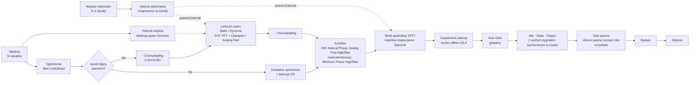
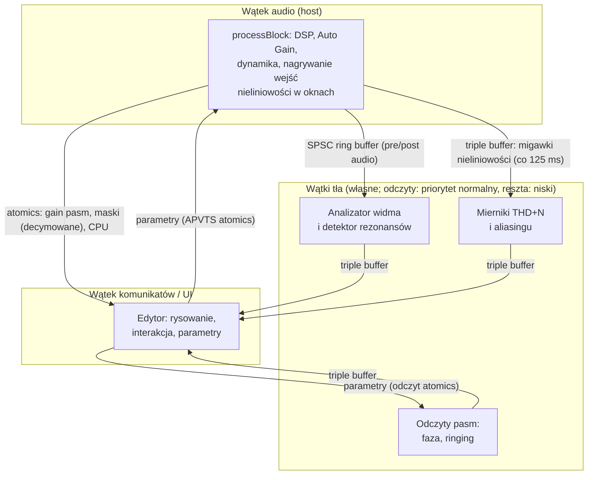

# Architektura — Sam Spectral Control

Status: **zrealizowana w M1–M8 (wersja 1.0.0)**. Dokument realizuje ARC-1…ARC-6 z [PROMPT.md](../PROMPT.md). Uzasadnienia decyzji są w [ADR](decisions/), a podstawy merytoryczne w [research](research/); tam też, w sekcjach „Realizacja w M…”, są odstępstwa od propozycji z M0 i wyniki pomiarów.

## 1. Zasady nadrzędne

1. **Determinizm audio.** Wszystko, co wpływa na dźwięk (DSP, Auto Gain, dynamika), liczy się w wątku audio, deterministycznie. Wątki tła produkują wyłącznie dane do wyświetlania. Dzięki temu render offline brzmi tak samo jak odtwarzanie (NFR-3).
2. **Real-time safety.** W wątku audio nie ma alokacji, blokad, I/O ani logowania; wszystko jest prealokowane w `prepareToPlay` dla maksymalnej konfiguracji (32 kanały, 24 pasma, 8× OS). Weryfikacja: RealtimeSanitizer (Clang 20, `[[clang::nonblocking]]` na ścieżce audio) i licznik alokacji w testach obciążeniowych — w CI i lokalnie (`tools/ci/local-check.sh`).
3. **Rdzeń bez GUI.** Kod DSP (`src/core`, biblioteka `ssc_core`) nie zależy od JUCE ani od `AudioProcessor` (FFT: pffft). Jest w całości testowalny w izolacji (ARC-5).
4. **Jedno źródło prawdy dla odczytów.** Odczyty (faza, ringing, THD/aliasing) liczy ten sam kod DSP, który przetwarza audio.

## 2. Tor sygnału (ARC-1)



Uwagi:
- **Lookahead**: tor główny jest opóźniony o `Max Lookahead`, a detekcja pasm Dynamic czyta historię wejścia z wyprzedzeniem (research/06). Pasma Spectral nie używają lookahead — ramka STFT i tak wyprzedza transjent.
- **Korektor** działa na bazowym fs po decymacji: jeden FIR na kanał (albo na składową M/S pary) koryguje sumaryczny błąd łańcucha, więc opóźnienie D występuje tylko raz. Korekcja jest dokładna, gdy pasma działające na danej parze są „diagonalne” w jednej bazie — wszystkie w {All, Left, Right} (korekcja per kanał) albo wszystkie w {All, Mid, Side} (korekcja w M/S); przy mieszaniu baz jest przybliżona (ADR-0005). W Minimum Phase High/Max korektor jest minimalnofazowy (z cepstrum), poprawia tylko amplitudę i nie ma latencji (research/08).
- **Silnik STFT** przetwarza tylko lane, na których działa co najmniej jedno pasmo Spectral; pozostałe lane omijają go z wyrównaniem opóźnienia.
- **Kanały nieobjęte pasmami** omijają oversampling, pasma i nieliniowości — dostają tylko opóźnienie równe latencji (CH-6, bit w bit).
- **Tor suchy** (Mix, Delta, Bypass) jest opóźniony o całą latencję. Delta = suchy − przetworzony bez korekcji Auto Gain (GLB-2, AG-5); Auto Gain nie wpływa też na Solo.
- **Solo** gra wyjście (Mix, Delta i Output, bez korekcji Auto Gain) przez filtr obszaru pasma (`auditionShapeFor`: pasmowy dla dzwonów, 12 dB/okt. dla półek i cięć, szeroki dla nachyleń) i tylko na celu pasma: lane z `makeLanes` (kanał, Mid albo Side pary) — Mid i Side grają jako mono (L = R = M) albo (L = S, R = −S), kanały spoza celu milkną. Słychać więc działanie pasma (podbicie, cięcie, Dynamic, Spectral) na jego rzeczywistym poziomie; wyświetlacz przyciemnia częstotliwości poza tym obszarem. Solo nie dodaje latencji.
- **Sidechain** (DYN-4): opcjonalna magistrala wejściowa (mono lub stereo) jest mapowana na kanały silnika — lewy kanał pary słucha lewego kanału sidechaina, prawy prawego, kanały bez pary środka (L + R)/2, sidechain mono wszystkich — i zapisywana do własnej historii obok historii wejścia (z oversamplingiem przez drugi zestaw filtrów OS). Pasmo Dynamic z External czyta detekcję z tej historii z tym samym wyprzedzeniem Lookahead; silnik STFT dostaje sidechain opóźniony o lookahead + latencję OS + korektora, wyrównany z ramką toru głównego, i dla pasm External liczy poziomy z jego widma. Sidechain nie trafia na wyjście i nie zmienia latencji.
- **Render offline (OS-4)**: gdy oversampling renderu różni się od czasu rzeczywistego, latencja jest większą z dwóch, a krótszy tor jest dopełniany opóźnieniem — host widzi stałą latencję.

### Budżet latencji

| Składnik | Kiedy | Wartość (48 kHz) |
|---|---|---|
| Oversampling | OS > 1× | zależnie od typu filtra (IIR: kilka próbek; FIR: dziesiątki); przy osobnym ustawieniu renderu offline (OS-4) — większa z dwóch latencji, krótszy tor dopełniony opóźnieniem |
| Natural Phase | tryb Natural Phase | D = 16 / 32 / 64 / 128 próbek (Eco…Max; stałe w ms, skalowane z fs) |
| Analog Feel | High / Max (wewnętrzny 2× / 4× i korektor) | 125 / 224 próbki |
| Max Lookahead | > 0 | 0–20 ms |
| Silnik STFT | istnieje ≥ 1 pasmo w trybie Spectral | N_fft = 2048 / 4096 / 8192 / 8192 próbek (Eco…Max, skalowane z fs) |

Zmierzone wartości: [measurements/latency.md](measurements/latency.md).

Latencja całkowita jest sumą składników i zmienia się wyłącznie po jawnej zmianie konfiguracji przez użytkownika (ADR-0011). Parametr Mode pasma nie jest automatyzowalny, bo zmiana Static/Dynamic ↔ Spectral może włączyć silnik STFT.

## 3. Model kanałów i pasm

- `ChannelTopology` (z `AudioChannelSet`): kanały z typem semantycznym, grupy, pary symetryczne, single — zob. [research §4](research/04-kanaly-surround-atmos.md).
- `BandTarget { SpeakerMask speakers; Component component; }` zapisany semantycznie (preset przenośny między układami).
- **Lane** = kanał albo składowa M/S pary. Każde pasmo ma stan filtrów per lane; M/S kodowane lokalnie w paśmie.
- Pasma przetwarzane szeregowo w kolejności indeksów. Dla pasm liniowych kolejność nie ma wpływu na wynik; dla nieliniowych (Character, Analog Feel) ma niewielki wpływ — opisany w [manualu](manual.md#7-character).

## 4. Moduły i struktura repozytorium

```
CMakeLists.txt, CMakePresets.json   – presety: release, dev, core-tests, sanitize, rtsan
cmake/                 – opcje kompilatora, ostrzeżenia jako błędy, sanitizery
external/JUCE          – submoduł git, JUCE 9.0.3 (ADR-0001)
external/pffft         – submoduł git, FFT (ADR-0013)
external/Catch2        – submoduł git, testy (tylko testy)
src/core/              – rdzeń DSP bez GUI i bez JUCE (ssc_core, ARC-5)
  util/                – linie opóźniające, wygładzanie, SPSC FIFO, triple buffer, SSC_REALTIME
  fft/                 – RealFft (pffft)
  filters/             – projekty dopasowane, sekcje, SVF-TPT, Character, krzywe Analog Feel
  dynamics/            – detektor, komputer wzmocnienia, wygładzanie
  spectral/            – silnik STFT/WOLA pasm Spectral
  phase/               – korektor (Natural Phase, Analog Feel, Minimum Phase High/Max)
  oversampling/        – IIR polifazowy i FIR półpasmowy
  loudness/            – ISO 226, model głośności, Auto Gain
  analysis/            – analizator, aktywność, rezonanse, odczyty pasm i całego EQ, miernik zniekształceń
  engine/              – Engine, BandProcessor, ChannelTopology, tabele wzmocnień, typy
src/plugin/            – AudioProcessor, parametry (APVTS), stan i migracja, presety,
                         usługi wątków tła (analizator, odczyty, mierniki)
src/ui/                – edytor: EqDisplay, BandPanel (+ Advanced pasma), SpeakerPanel, ControlBar
                         (+ globalny Advanced), PresetBar, MeterView, Controls (przyciski), Motion
                         (animacje), PanelLayout (dokowanie), logika edycji pasm, motyw
tests/core, tests/plugin – Catch2 v3: rdzeń; procesor, logika UI, presety, testy obciążeniowe
tools/                 – ssc_measure (raporty w docs/measurements), ssc_benchmark (CPU),
                         ssc_screenshot, ssc_resonance_eval, third-party-notices.py,
                         ci/ (local-check.sh, vst3-validator.sh)
packaging/             – LICENSE.txt, macos/ (pkgbuild/productbuild, notaryzacja,
                         deinstalator), windows/ (Inno Setup)
.github/workflows/     – ci.yml (build, testy, walidacja), release.yml (podpisy, instalatory)
docs/                  – research, ADR, architektura, testy, pomiary, wydanie, instrukcja
```

## 5. Parametry i stan

- `AudioProcessorValueTreeState` z jawnym `ParameterLayout`. ID parametrów stabilne (`b07_freq`, `b07_mode`, `phase_mode`…), wersjonowane (`ParameterID{ id, version }` w JUCE). Parametry zmieniające latencję (Phase Mode, Quality, Oversampling, Offline Oversampling, Max Lookahead, Mode pasma) nie są automatyzowalne (ADR-0011).
- Parametry ciągłe są wygładzane (Output, Mix, Bypass, Delta: rampa 20 ms; parametry pasm — interpolacja w pod-blokach sterowania); zmiana topologii pasma (kształt, nachylenie, cel) przechodzi przenikaniem ≈ 10 ms między dwiema instancjami filtra.
- **Ścieżka parametrów w wątku audio**: procesor czyta atomics APVTS na początku bloku hosta; silnik dzieli blok na fragmenty ≤ 512 próbek, a pasma aktualizują współczynniki co pod-blok sterowania (32 / 16 / 8 / 4 próbki dla Eco…Max). Zmiana fc/Q/kształtu przelicza projekt pasma; pasma Dynamic interpolują parametry SVF z tabeli wzmocnień (research/06).
- Stan niebędący parametrami (rozmiar okna, ustawienia analizatora, sloty A/B, nazwa presetu) w dzieciach `ValueTree`; atrybut `version` + funkcje migracji.

## 6. Wątki i komunikacja (ARC-4)



- FIFO: jednoproducentowe/jednokonsumenckie, prealokowane; przy przepełnieniu producent zapisuje tylko to, co się mieści, a resztę (najnowsze próbki) odrzuca (wizualizacja może zgubić fragment — audio nigdy nie czeka).
- Telemetria dużych tablic (maski spektralne) — decymowana do ≤ 512 punktów i przekazywana przez triple buffer.
- Odczyty pasm (`ReadoutService`) mają priorytet normalny, pozostałe wątki tła — niski: użytkownik czeka na odczyty, kręcąc pokrętłem (PR-2, do 100 ms), a na macOS niski priorytet to klasa QoS *utility*, której oczekiwania system może odkładać. Zmiana parametru z wątku komunikatów budzi wątek odczytów od razu (ok. 1–2 ms zamiast do 50 ms); automatykę hosta z wątku audio wątek odczytów zauważa co 50 ms, bo budzenie wątku nie jest bezpieczne w czasie rzeczywistym.
- Wątki tła działają tylko przy otwartym edytorze (klienci `AnalyzerService`, `ReadoutService`, `MeterService`); bez edytora wątek audio nie nagrywa też migawek mierników (`Engine::setDistortionMetering`).
- Mierniki (§13e): wątek audio podłącza rejestratory pasm tylko na okno na końcu każdego 125-milisekundowego okresu i publikuje migawkę przez triple buffer; analiza (replika ADAA i cień bez próbkowania) działa w `MeterService`.

## 7. Wydajność (NFR-1)

- Stała częstotliwość sterowania niezależna od bufora hosta (pod-bloki 4–32 próbek wg Quality); wynik jest identyczny dla każdego rozmiaru bufora (NFR-3).
- FFT przez pffft (SIMD); filtry pasm bez jawnego SIMD — budżety NFR-1 spełnione bez niego (wektoryzacja lane'ów stereo to możliwa optymalizacja).
- Denormale: `juce::ScopedNoDenormals` na wejściu `processBlock`; testy obciążeniowe sprawdzają brak wartości subnormalnych na wyjściu.
- Benchmark `ssc_benchmark` mierzy scenariusze z NFR-1 i tryby fazy × Quality: [measurements/cpu.md](measurements/cpu.md), [benchmarks.md](benchmarks.md).

## 8. Budowanie i CI

- CMake ≥ 3.25, C++20, `CMakePresets.json`. Formaty: VST3 (P0), AU (P1, `SSC_FORMAT_AU`); AAX i CLAP — poza 1.0.
- GitHub Actions (`ci.yml` — pull requesty, push do `main`/`master`, ręcznie; docs/release.md):
  - `ubuntu-24.04`: build GCC z `-Werror`, testy, pluginval (strictness 10, Xvfb), walidator VST3 Steinberga, aktualność `THIRD-PARTY-NOTICES.txt`, RealtimeSanitizer (Clang 20), ASan/UBSan, clang-format,
  - `macos-14`: universal binary, testy, pluginval, walidator VST3,
  - `windows-2022`: x64, testy, pluginval, walidator VST3,
  - `release.yml`: bramka wydania, podpis, notaryzacja, instalatory (sekrety opcjonalne; bez nich artefakty niepodpisane).
- Te same kontrole lokalnie: `tools/ci/local-check.sh`.

## 9. Testy

- **Jednostkowe** (Catch2 v3): wszystkie kryteria liczbowe z notatek researchu (`docs/traceability.md`).
- **Pomiarowe** (`ssc_measure`): dokładność filtrów, zniekształcenia, latencja, Auto Gain, detektor rezonansów — raporty w [docs/measurements/](measurements/README.md).
- **Obciążeniowe** (`[TST-4]`): układy kanałów, częstotliwości próbkowania, rozmiary bufora, automatyzacja, błędy hosta — [testing.md](testing.md).
- **Walidacja wtyczki**: pluginval (strictness 10), Steinberg VST3 validator, auval.
- **Hosty**: checklista w [`docs/testing.md`](testing.md).

## 10. Ryzyka i otwarte kwestie

| Ryzyko | Wpływ | Działanie |
|---|---|---|
| Licencja JUCE (AGPLv3 vs komercyjna) | dystrybucja binarek | rozstrzygnięte: AGPLv3, kod publiczny (ADR-0002) |
| Znaki towarowe (Neve, Pultec, SSL) | nazewnictwo UI/marketing | neutralne nazwy, konsultacja prawna (ADR-0009) |
| Patenty na dynamikę w dziedzinie częstotliwości | wydanie komercyjne | analiza freedom-to-operate przed wydaniem |
| CPU silnika spektralnego w 9.1.6 / Max | NFR-1 | benchmark w M3, decymacja analizy, SIMD |
| Latencja trybu Spectral | ARC-3 | ADR-0011: latencja zmienia się tylko przy jawnej zmianie konfiguracji; Mode nieautomatyzowalny; Low Latency (P1) |
| Fałszywe podpowiedzi rezonansów | zaufanie użytkownika | ewaluacja precision/recall (M7), konserwatywne progi |
| Certyfikaty podpisu (Apple, Windows) | instalatory | konta i certyfikaty po stronie użytkownika (ADR-0014) |
| Testy Atmos poza CI | CH-2 | ręczna macierz hostów (`docs/testing.md`) |
| Tabele ISO 226:2023 | Auto Gain | formuła 2003 (różnica ≤ 0,6 dB), tabela wymienialna (ADR-0007) |
