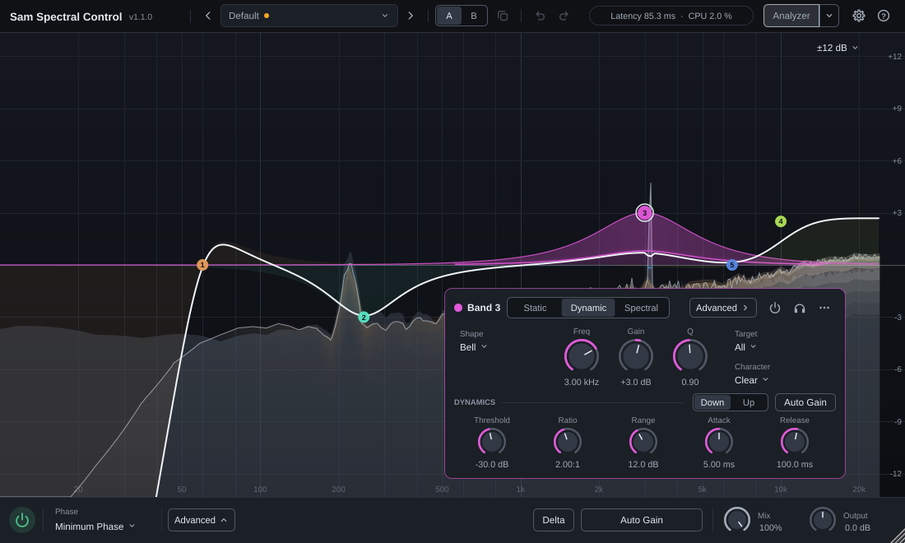
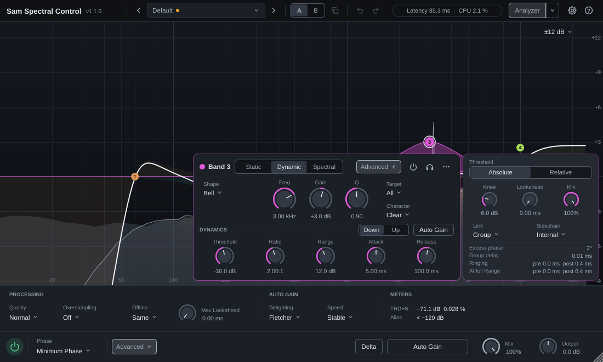
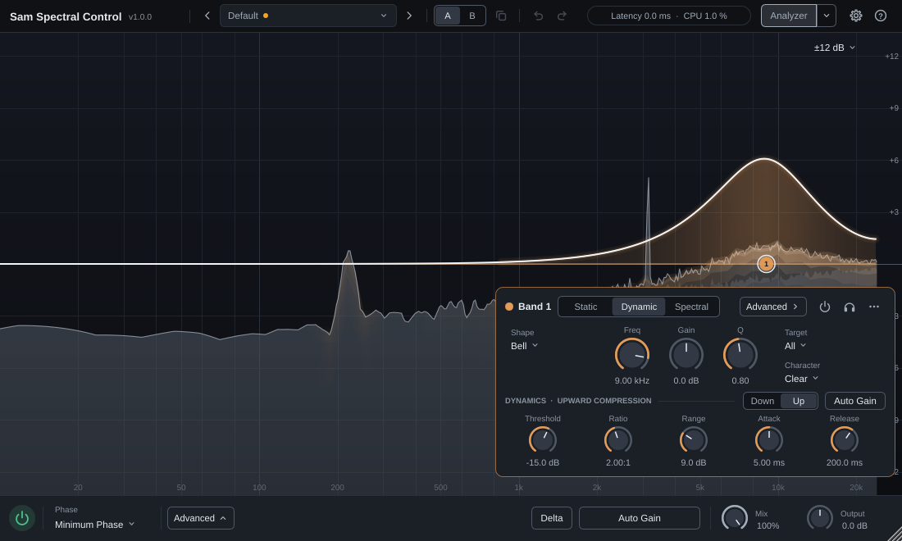
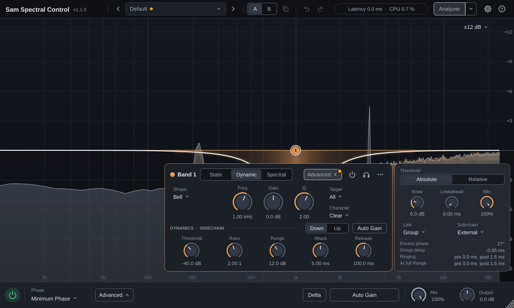
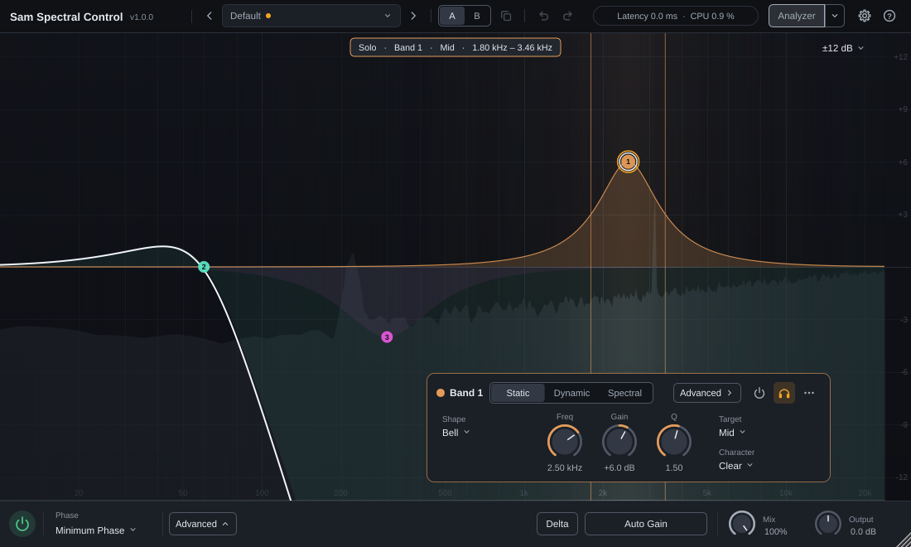

# Sam Spectral Control 1.0 — instrukcja obsługi

Sam Spectral Control to korektor (EQ) z 24 pasmami, z których każde może działać statycznie, dynamicznie albo spektralnie. Ma trzy tryby fazy (Minimum Phase, Natural Phase, Analog Feel), oversampling, Auto Gain, nasycenie pasm (Character), obsługę stereo M/S oraz układów surround i Atmos (m.in. 7.1.4 i 9.1.6, do 32 kanałów), a także analizator widma, odczyty fazy i ringingu oraz mierniki zniekształceń.

Interfejs wtyczki jest po angielsku — nazwy przycisków i parametrów podajemy w oryginale. Skróty klawiszowe zapisujemy w postaci *Cmd/Ctrl* (Cmd na macOS, Ctrl na Windows i Linuksie) oraz *Alt/Option*.

## Spis treści

1. [Instalacja](#1-instalacja)
2. [Szybki start](#2-szybki-start)
3. [Okno wtyczki](#3-okno-wtyczki)
4. [Pasma: tworzenie i edycja](#4-pasma-tworzenie-i-edycja)
5. [Kształty i parametry pasma](#5-kształty-i-parametry-pasma)
6. [Tryby pasma: Static, Dynamic, Spectral](#6-tryby-pasma-static-dynamic-spectral)
7. [Character](#7-character)
8. [Tryby fazy i Quality](#8-tryby-fazy-i-quality)
9. [Oversampling i render offline](#9-oversampling-i-render-offline)
10. [Auto Gain](#10-auto-gain)
11. [Ustawienia globalne i odsłuch](#11-ustawienia-globalne-i-odsłuch)
12. [Analizator i wizualizacja](#12-analizator-i-wizualizacja)
13. [Mierniki THD+N i aliasingu](#13-mierniki-thdn-i-aliasingu)
14. [Presety, A/B, Undo](#14-presety-ab-undo)
15. [Stereo, surround i Atmos](#15-stereo-surround-i-atmos)
16. [Latencja i automatyzacja](#16-latencja-i-automatyzacja)
17. [Obciążenie procesora](#17-obciążenie-procesora)
18. [Znane ograniczenia](#18-znane-ograniczenia)
19. [Rozwiązywanie problemów](#19-rozwiązywanie-problemów)
20. [Licencje i znaki towarowe](#20-licencje-i-znaki-towarowe)

## 1. Instalacja

**Wymagania**: host obsługujący wtyczki VST3; macOS 11 lub nowszy (Apple silicon i Intel) albo Windows 10/11 64-bit. Wersję dla Linuksa buduje się ze źródeł (README projektu).

### macOS

Uruchom `SamSpectralControl-1.0.0-macOS.pkg`. W kroku *Customize* można wybrać komponenty:

| Komponent | Miejsce instalacji |
|---|---|
| VST3 plug-in | `/Library/Audio/Plug-Ins/VST3/Sam Spectral Control.vst3` |
| Audio Unit (jeśli jest w pakiecie) | `/Library/Audio/Plug-Ins/Components/Sam Spectral Control.component` |
| Uninstaller, licences and manual (zawsze) | `/Library/Application Support/Sam Spectral Control` |

Deinstalacja: uruchom `Uninstall Sam Spectral Control.command` z folderu `/Library/Application Support/Sam Spectral Control` (system poprosi o hasło administratora). Usuwa wtyczki, ten folder i wpisy instalatora; presety użytkownika zostają.

### Windows

Uruchom `SamSpectralControl-1.0.0-Windows.exe`. Wtyczka trafia do `C:\Program Files\Common Files\VST3\Sam Spectral Control.vst3`, a licencje i (opcjonalnie) instrukcja do `C:\Program Files\Sam Audio\Sam Spectral Control`. Deinstalacja: *Ustawienia → Aplikacje → Zainstalowane aplikacje → Sam Spectral Control*.

### Ostrzeżenia systemu przy instalatorach bez podpisu

Wydanie 1.0.0 nie jest podpisane cyfrowo (wydanie wstępne), więc systemy ostrzegają przed pierwszym uruchomieniem instalatora. Sumę SHA-256 pobranego pliku można porównać z `SHA256SUMS.txt` ze strony wydania (macOS: `shasum -a 256 <plik>`, Windows: `certutil -hashfile <plik> SHA256`).

- **macOS**: po dwukliku pojawia się komunikat, że Apple nie może sprawdzić pliku. Zamknij go, otwórz *Ustawienia systemowe → Prywatność i ochrona*, w sekcji *Ochrona* kliknij *Otwórz mimo to* przy nazwie instalatora i potwierdź hasłem. W macOS 15 i nowszych otwieranie przez Control-klik już nie omija tej blokady.
- **Windows**: SmartScreen pokazuje okno „System Windows ochronił ten komputer” — wybierz *Więcej informacji → Uruchom mimo to*. Także podpisane instalatory nowego wydawcy mogą przez pierwsze tygodnie wywoływać to ostrzeżenie, zanim zbudują reputację.

### Po instalacji

Uruchom host i — jeśli wtyczka się nie pojawia — wykonaj ponowne skanowanie wtyczek. Sam Spectral Control jest w kategorii *Fx / EQ*.

## 2. Szybki start

1. Wstaw wtyczkę na ścieżkę lub szynę. Widać analizator widma: szary — sygnał przed korekcją (*pre*), jasny — po korekcji (*post*).
2. **Kliknij dwukrotnie** w wykres, żeby dodać pasmo Bell w tym miejscu (wysokość kliknięcia = wzmocnienie). Albo **złap krzywą** i przeciągnij — powstaje Bell lub półka.
3. Przeciągaj **węzeł** pasma: w poziomie zmienia częstotliwość, w pionie wzmocnienie. **Kółko myszy** nad węzłem zmienia Q. Z *Shift* — precyzyjnie.
4. Kliknięty węzeł otwiera pod sobą **panel pasma** z parametrami jego trybu. **Prawy przycisk** na węźle otwiera menu (kształt, nachylenie, tryb, cel, Character, Solo, kopiowanie…).
5. Żeby pasmo działało tylko wtedy, gdy trzeba, przełącz je w panelu na **Dynamic** (np. de-esser) albo **Spectral** (tłumienie rezonansów) — pojawią się pokrętła dynamiki. Ustawienia specjalistyczne (detektor, odczyty) są pod przyciskiem **Advanced ›**.
6. Wynik porównasz przełącznikiem **A | B**, zapiszesz jako preset (pole z nazwą presetu → *Save As…*), a zmiany cofniesz strzałkami **Undo/Redo** lub *Cmd/Ctrl+Z*.

## 3. Okno wtyczki

Okno ma trzy poziomy: to, czego używa się w każdej sesji, jest zawsze widoczne; **panel pasma** pojawia się po wybraniu pasma i pokazuje tylko parametry jego trybu; ustawienia specjalistyczne czekają za przyciskami **Advanced** — pasma i globalnym.

| Obszar | Zawartość |
|---|---|
| Nagłówek (od lewej) | nazwa i wersja; presety: `‹` pole z nazwą `›`; **A \| B** i kopiowanie; **Undo** i **Redo**; latencja i obciążenie procesora; **Analyzer** (lewa część włącza i wyłącza widmo, ▾ otwiera jego ustawienia); **⚙** (animacje, rozmiar okna); **?** (pomoc) |
| Wykres | analizator, krzywe pasm i krzywa sumaryczna, węzły pasm, poświata aktywności, podpowiedzi rezonansów, nakładka fazy; w prawym górnym rogu zakres skali EQ |
| Panel pasma | parametry wybranego pasma, pod jego węzłem ([rozdz. 4](#panel-pasma)) |
| Advanced pasma | wysuwa się z boku panelu pasma: ustawienia detektora pasm Dynamic i Spectral, odczyty fazy i ringingu |
| Pasek dolny | włącznik wtyczki, **Phase** (i **Model** w trybie Analog Feel), **Advanced**, **Delta**, **Auto Gain**, **Mix**, **Output** |
| Globalny Advanced | wysuwa się z paska dolnego: **Quality**, **Oversampling**, **Offline**, **Max Lookahead**, ważenie i szybkość Auto Gain, mierniki THD+N i aliasingu |

**Kropka** na przycisku oznacza, że coś schowanego odbiega od ustawień domyślnych albo wymaga uwagi — podpowiedź przycisku mówi co. Bursztynowa: zmienione ustawienie (np. Quality High), podpowiedź oversamplingu, preset zmieniony od wczytania; czerwona: miernik ponad progiem ostrzeżenia.

**Status** (w nagłówku): całkowita latencja i obciążenie procesora przez wtyczkę; w podpowiedzi latencja w próbkach i współczynnik oversamplingu. Gdy latencja się zmienia, status na chwilę świeci na bursztynowo. Bieżącą korekcję Auto Gain pokazuje przycisk **Auto Gain**.

**Rozmiar okna** zmienia się, ciągnąc za prawy dolny róg (od 860 × 480 do 2600 × 1600 pikseli), albo w menu **⚙ → Window Size**: Small 860 × 480, Medium 1100 × 660, Large 1400 × 840, Extra Large 1800 × 1080. Rozmiar, otwarte panele Advanced i animacje zapisują się w projekcie.

**Animacje** (**⚙ → Animations**): *Full* — panele wysuwają się i przesuwają płynnie (110–200 ms); *Reduced* — tylko krótkie przenikania; *Off* — bez ruchu. Animowana jest tylko rama interfejsu: krzywe i wartości zmieniają się zawsze od razu.

**Skala EQ** (prawy górny róg wykresu): ±3, ±6, ±12 (domyślnie), ±18 lub ±30 dB — zmienia tylko widok, nie dźwięk.

**Pomoc** (**?**): *User Manual* otwiera zainstalowaną instrukcję (`Manual.md`), *Mouse and Keyboard* — ściągę gestów i skrótów, *About* — wersję i informacje o licencjach.

Większość elementów ma podpowiedzi (*tooltips*) po najechaniu kursorem — m.in. koszt trybów fazy i Quality, opis modeli Analog Feel i szczegóły mierników.

## 4. Pasma: tworzenie i edycja

### Tworzenie

Wtyczka ma 24 pasma. Gdy kursor jest nad pustym miejscem wykresu, przerywana linia pokazuje pasmo, które powstanie.

**Dwuklik w tło** tworzy pasmo zależnie od miejsca:

| Miejsce | Kształt |
|---|---|
| skrajne lewe 4 % szerokości (poniżej ok. 14 Hz) | Low Cut (24 dB/okt.) |
| skrajne prawe 4 % (powyżej ok. 22 kHz) | High Cut (24 dB/okt.) |
| dolne 12 % wysokości (przy skali ±12 dB poniżej ok. −10 dB) | Notch (Q 4) |
| reszta wykresu | Bell; wzmocnienie = wysokość kliknięcia |

**Przeciągnięcie krzywej sumarycznej** tworzy pasmo i od razu je przesuwa (jeden krok Undo):

| Miejsce | Kształt |
|---|---|
| lewe 15 % szerokości (poniżej ok. 33 Hz) | Low Shelf |
| prawe 15 % (powyżej ok. 9 kHz) | High Shelf |
| reszta | Bell |

Kształt można później zmienić w menu pasma albo w panelu.

### Edycja na wykresie

| Gest | Działanie |
|---|---|
| przeciągnięcie węzła | częstotliwość (poziomo) i wzmocnienie (pionowo); dla kształtów bez wzmocnienia (cięcia, Notch, Band Pass, All Pass) pionowo zmienia się Q |
| *Shift* + przeciągnięcie | 10 × dokładniej (można włączyć w trakcie ruchu) |
| kółko myszy nad węzłem | Q (z *Shift* dokładniej) |
| dwuklik w węzeł | włączenie / wyłączenie pasma |
| *Alt/Option* + przytrzymanie węzła | chwilowy odsłuch pasma (Solo), dopóki trzymasz przycisk |
| *Cmd/Ctrl* + klik | dodanie węzła do zaznaczenia lub usunięcie z niego |
| przeciągnięcie w tle | zaznaczenie prostokątem (z *Cmd/Ctrl* — dodanie do zaznaczenia) |
| prawy przycisk na węźle | menu pasma |

Przeciąganie lub kółko myszy na węźle należącym do zaznaczenia zmienia **wszystkie zaznaczone pasma** naraz (względnie). Operacje z menu też działają na całe zaznaczenie.

### Skróty klawiszowe (gdy aktywny jest wykres)

| Skrót | Działanie |
|---|---|
| *Delete* / *Backspace* | usuń zaznaczone pasma |
| *Cmd/Ctrl+Z* | cofnij |
| *Cmd/Ctrl+Shift+Z* lub *Ctrl+Y* | ponów |
| *Cmd/Ctrl+A* | zaznacz wszystkie pasma |
| *Esc* | wyczyść zaznaczenie |

Niektóre hosty przechwytują skróty klawiszowe; wtedy użyj przycisków Undo/Redo w nagłówku albo menu pasma. Kliknięcie przycisków wtyczki nie zabiera wykresowi klawiatury, więc skróty działają dalej. Ściągę gestów i skrótów pokazuje też **? → Mouse and Keyboard**.

### Menu pasma (prawy przycisk)

*Shape*, *Slope* (dla cięć, półek i Band Pass) albo *Q* (gotowe wartości 0,5–16), *Mode*, *Direction* (*Down* / *Up*, [rozdz. 6](#kompresja-w-górę)), *Target*, *Character*, *Auto Gain*, *External Sidechain* (detekcja z wejścia sidechain, [rozdz. 6](#sidechain)), *Bypass*, *Solo*, *Copy*, *Paste*, *Reset* (wartości domyślne pasma), *Delete*. Tryby Dynamic i Spectral są dostępne tylko dla kształtów ze wzmocnieniem; *Direction*, *Auto Gain* i *External Sidechain* — tylko w tych trybach.

### Panel pasma

Kliknięcie węzła pokazuje panel pasma pod węzłem (gdy zasłaniałby węzeł — u góry wykresu albo obok niego). Panel pokazuje tylko to, co w trybie pasma działa:

| | Static | Dynamic | Spectral |
|---|---|---|---|
| Nagłówek | kolor i numer pasma; tryb **Static \| Dynamic \| Spectral**; **Advanced ›**; ⏻ — włączenie / wyłączenie pasma (czerwona lampka: wyłączone); 🎧 — Solo (kliknięcie: zostaje włączone, przytrzymanie: tylko na czas trzymania); ⋯ — *Copy*, *Paste*, *Reset*, *Delete* | jak Static | jak Static |
| Rząd EQ | **Shape**, **Slope** (cięcia, półki, Band Pass), **Freq**, **Gain**, **Q**, **Target**, **Character** (w surround także **Speakers**) | jak Static | jak Static |
| Rząd dynamiki | — | **Threshold**, **Ratio**, **Range**, **Attack**, **Release**; w jego nagłówku **Down \| Up** i **Auto Gain** | **Threshold**, **Selectivity**, **Range**, **Attack**, **Release**; w jego nagłówku **Down \| Up** i **Auto Gain** |
| Panel **Advanced** pasma | odczyty | **Threshold Mode**, **Knee**, **Lookahead**, **Mix**, **Link**, **Sidechain**, odczyty | **Threshold Mode**, **Knee**, **Ratio**, **Mix**, **Link**, **Sidechain**, odczyty |

Tryby Dynamic i Spectral są dostępne tylko dla kształtów ze wzmocnieniem. Nagłówek rzędu dynamiki nazywa działanie pasma, gdy nie jest to zwykła kompresja (**UPWARD COMPRESSION**, **EXPANSION**, **UPWARD EXPANSION**), a gdy pasmo słucha wejścia sidechain, ma dopisek **SIDECHAIN** ([rozdz. 6](#sidechain)). **Advanced ›** wysuwa panel z boku panelu pasma — zwykle z prawej, z lewej, gdy z prawej zasłaniałby węzeł — i zostaje otwarty także dla kolejnych pasm, aż się go zamknie (**‹**). Kropka na **Advanced** oznacza ustawienie detektora inne niż domyślne dla trybu pasma (np. Threshold Mode Absolute w paśmie Spectral) albo ostrzeżenie o słyszalnym ringingu ([rozdz. 12](#odczyty-pasma)).

Pokrętła reagują na przeciąganie (z *Shift* — precyzyjnie); **dwuklik** przywraca wartość domyślną; wartość pod pokrętłem można kliknąć i wpisać. Częstotliwość przyjmuje zapisy `1500`, `1.5k`, `1.5 kHz`; czasy — `12`, `12 ms`, `1.2 s`.

## 5. Kształty i parametry pasma

| Kształt | Gain | Q / Slope | Uwagi |
|---|---|---|---|
| **Bell** | ±30 dB | Q 0,025–40 | dzwon; szerokość wg Q |
| **Low Shelf**, **High Shelf** | ±30 dB | Slope 6–48 dB/okt.; Q kształtuje przejście (0,71 = bez przerostu) | półki |
| **Low Cut**, **High Cut** | — | Slope 6, 12, 18, 24, 30, 36, 48, 72, 96 dB/okt. lub Brickwall; Q = rezonans na częstotliwości odcięcia (0,71 = płasko) | filtry górno-/dolnoprzepustowe Butterwortha |
| **Notch** | — | Q | wycięcie |
| **Band Pass** | — | Slope 6–48 dB/okt. | przepuszcza tylko pasmo wokół częstotliwości |
| **Tilt Shelf** | ±30 dB | Slope 6 lub 12 dB/okt. | para półek wokół częstotliwości: −Gain/2 poniżej, +Gain/2 powyżej |
| **Flat Tilt** | ±30 dB | — | stałe nachylenie od 20 Hz do 20 kHz (ok. Gain/10 dB na oktawę), punkt obrotu w częstotliwości pasma |
| **All Pass** | — | Q | zmienia tylko fazę (np. do wyrównania fazy z innym torem) |

Parametry statyczne: **Freq** 10 Hz – 30 kHz (domyślnie 1 kHz), **Gain** ±30 dB, **Q** 0,025–40 (domyślnie 1), **Slope** jak w tabeli (domyślnie 12 dB/okt., cięcia tworzone na wykresie — 24 dB/okt.).

**Brickwall** (bardzo strome cięcie): w Natural Phase realizowany jako filtr o fazie liniowej, gdy częstotliwość odcięcia jest dość wysoka — od ok. 10 kHz (Eco), 5,2 kHz (Normal), 2,6 kHz (High), 1,3 kHz (Max) przy 48 kHz; poniżej i w pozostałych trybach fazy to cięcie 96 dB/okt.

Filtry są projektowane tak, by ich amplituda odpowiadała prototypom analogowym także w pobliżu częstotliwości Nyquista (bez typowego „ściskania” krzywych przy wysokich częstotliwościach) — najdokładniej w Natural Phase oraz w Minimum Phase przy Quality High i Max.

## 6. Tryby pasma: Static, Dynamic, Spectral

| Tryb | Co robi | Latencja |
|---|---|---|
| **Static** | stałe wzmocnienie (zwykły EQ) | 0 |
| **Dynamic** | wzmocnienie pasma zmienia się z poziomem sygnału w obszarze pasma | 0 (plus Lookahead, jeśli ustawiony) |
| **Spectral** | w obszarze pasma działa tylko na te częstotliwości, które przekraczają próg (np. pojedyncze rezonanse), resztę zostawia | ramka STFT, patrz niżej |

Dynamic i Spectral są dostępne dla kształtów ze wzmocnieniem (Bell, półki, Tilt Shelf, Flat Tilt). Pasmo dynamiczne pokazuje na wykresie bieżące wzmocnienie, a jego obszar świeci, gdy pracuje.

W panelu pasma rząd dynamiki zawiera to, czym ustawia się dany tryb (Dynamic: Threshold, Ratio, Range, Attack, Release; Spectral: Threshold, Selectivity, Range, Attack, Release), a w jego nagłówku jest kierunek **Down | Up** i **Auto Gain**; pozostałe parametry z tabeli niżej są w panelu **Advanced** pasma ([rozdz. 4](#panel-pasma)).

**Wzmocnienie pasma = Gain + część dynamiczna** (w granicach ±Range, pomnożona przez Mix pasma). Gain 0 dB i Range 6 dB to pasmo, które samo w sobie nic nie robi, a tłumi lub podbija do 6 dB tylko wtedy, gdy zadziała próg.

### Parametry dynamiki

| Parametr | Zakres (domyślnie) | Znaczenie |
|---|---|---|
| **Threshold Mode** | Absolute / Relative | Absolute — próg w dBFS; Relative — próg względem otoczenia w widmie: działa na to, co wystaje ponad sąsiednie częstotliwości, prawie niezależnie od głośności materiału |
| **Threshold** | −80…+30 dB (Dynamic: Absolute −20 dB; Spectral: Relative +6 dB) | próg |
| **Ratio** | 0,1:1 … ∞:1 (2:1) | > 1 — kompresja, < 1 — ekspansja; 1:1 — brak działania |
| **Direction** | Down / Up (Down) | Down — pasmo tnie, Up — podbija (np. kompresja w górę); strona progu wynika z Ratio, patrz tabela niżej |
| **Range** | 0–30 dB (12 dB) | największa zmiana wzmocnienia |
| **Knee** | 0–24 dB (6 dB) | łagodność wejścia w działanie |
| **Attack**, **Release** | 0,05–500 ms (5 ms), 1–5000 ms (100 ms) | stałe czasowe (63 % zmiany): Attack — reakcja na **rosnący** poziom, Release — na malejący, w każdym kierunku (kompresor w dół tnie z czasem Attack, kompresor w górę z czasem Attack zabiera podbicie przy głośnym wejściu, bramka otwiera się z czasem Attack) |
| **Lookahead** | 0–20 ms (0) | tylko Dynamic: pasmo „widzi” sygnał z wyprzedzeniem i reaguje przed transjentem |
| **Mix** | 0–100 % (100 %) | ile działania dynamicznego trafia do wzmocnienia pasma (bez interferencji z sygnałem suchym, bo skaluje wzmocnienie, a nie miesza sygnały) |
| **Selectivity** | 0–100 % (50 %) | tylko Spectral: jak wąsko w częstotliwości działa maska — wyżej = bardziej „chirurgicznie” |
| **Link** | Independent / Pair / Group / All (Group) | czy kanały (lub składowe M/S) dzielą detekcję: wspólny poziom = maksimum poziomów w zbiorze |
| **Sidechain** | Internal / External (Internal) | skąd detekcja bierze poziom: Internal — z sygnału pasma, External — z wejścia sidechain wtyczki ([niżej](#sidechain)) |

Po przełączeniu pasma w tryb Spectral z nieruszonym progiem Dynamic (Absolute −20 dB) wtyczka ustawia Relative +6 dB — i odwrotnie.

| Direction | Ratio > 1 (kompresja) | Ratio < 1 (ekspansja) |
|---|---|---|
| **Down** | tłumi to, co przekracza próg (kompresja — de-esser, poskramianie rezonansów) | tłumi to, co jest poniżej progu (ekspansja w dół, jak bramka) |
| **Up** | podbija to, co jest poniżej progu (**kompresja w górę**) | podbija to, co przekracza próg (ekspansja w górę) |

### Kompresja w górę

**Up** z Ratio powyżej 1:1 podnosi obszar pasma, kiedy jest cichszy niż próg: o (próg − poziom) · (1 − 1/Ratio), najwyżej o **Range**. Głośne fragmenty (powyżej progu) zostają bez zmian, więc różnica między cichymi a głośnymi maleje „od dołu” — wychodzą szczegóły, pogłos, cichsze sylaby, a szczyty się nie zmieniają. Przykłady: podniesienie wybrzmień i detali w górnym paśmie, wyciągnięcie dołu basu, gdy gra cicho, równowaga barwy wokalu między cichymi i głośnymi frazami.

- **Threshold**: kilka dB poniżej poziomu głośnych fragmentów w obszarze pasma; wszystko, co pod nim, jest podnoszone.
- **Ratio** 2:1–4:1 i **Range** 3–9 dB na początek; Range ogranicza podbicie.
- **Attack** (np. 1–10 ms) — jak szybko podbicie znika, kiedy wchodzi głośny dźwięk; krótki chroni transjenty przed podbiciem. **Release** (np. 100–500 ms) — jak szybko podbicie wraca w cichych fragmentach; dłuższy oznacza mniej „pompowania”.
- W pauzach i ciszy poziom jest poniżej progu, więc pasmo podnosi też szum tła — najwyżej o Range. Przy zaszumionym materiale użyj mniejszego Range.
- W trybie **Spectral** Up podnosi tylko te częstotliwości w obszarze pasma, które są pod progiem. Z progiem **Relative** ustaw go poniżej 0 dB (np. −6 dB): podnosi wtedy tylko częstotliwości wyraźnie cichsze od otoczenia, czyli wypełnia „dziury” w widmie. Domyślne +6 dB podniosłoby prawie cały obszar.
- Z **Sidechain: External** pasmo Up podnosi się, gdy sidechain cichnie — np. gitara w pauzach wokalu (odwrotność duckingu).
- **Auto Gain** pasma oddaje średnie podbicie, więc pasmo zmienia dynamikę, a nie średni poziom.

Projekty, presety i skopiowane pasma z wersji 1.0 (gdzie zamiast Down / Up był wybór Above / Below) są przy wczytaniu przeliczane i brzmią tak samo: w pasmach, które działały poniżej progu, wartości Attack i Release zamieniają się miejscami, bo w 1.0 Attack oznaczał narastanie zmiany, a nie reakcję na rosnący poziom.

### Lookahead i Max Lookahead

Tor główny jest opóźniony o globalny parametr **Max Lookahead** (0–20 ms, w globalnym panelu **Advanced** i w parametrach hosta), a pasmo Dynamic z Lookahead *L* czyta detekcję z wyprzedzeniem *L*. Ustawienie Lookahead pasma większego niż Max Lookahead automatycznie podnosi Max Lookahead — latencja wtyczki rośnie o tę wartość i host ją kompensuje. Max Lookahead się nie obniża sam: zmniejsz go ręcznie, gdy już nie jest potrzebny.

### Sidechain

Pasmo Dynamic lub Spectral z **Sidechain: External** (panel **Advanced** pasma albo *External Sidechain* w menu węzła) mierzy poziom w sygnale wejścia **Sidechain** wtyczki, a przetwarza dalej własny sygnał. Przykłady: miejsce dla wokalu w podkładzie (Bell 1–4 kHz na podkładzie, sidechain z wokalu), dla stopy w basie (Bell lub Low Shelf na basie, sidechain ze stopy), de-esser sterowany innym śladem.

- **Wejście Sidechain** to dodatkowa magistrala wejściowa wtyczki — mono albo stereo, domyślnie wyłączona. Włącza się ją i kieruje na nią sygnał w hoście: np. w Cubase przyciskiem sidechain w nagłówku okna wtyczki, w Studio One, Reaperze, Ableton Live czy Bitwigu wyborem źródła sidechain dla wtyczki (nazwy w hostach się różnią: *Sidechain*, *Side-Chain*, *Aux input*).
- Detekcja bierze z sidechaina to samo, co zwykle ze swojego sygnału: obszar wokół częstotliwości pasma (z jego Q i Selectivity) na **celu** pasma. **Left** słucha lewego kanału sidechaina, **Right** — prawego, **Mid** — (L + R)/2, **Side** — (L − R)/2, **All** — lewy kanał lewego, prawy prawego. Sidechain mono steruje wszystkimi kanałami. W surround lewe kanały par (L, Ls, Ltf…) słuchają lewego kanału sidechaina, prawe — prawego, a kanały bez pary (C, LFE) — jego środka (L + R)/2.
- Pozostałe parametry dynamiki (Threshold, Ratio, Direction, Range, Attack, Release, Knee, Lookahead, Link) działają jak zwykle. Próg **Relative** w paśmie Spectral liczy się względem otoczenia w widmie sidechaina.
- Sidechain jest wyrównany w czasie z torem głównym (także przy Lookahead, oversamplingu i Natural Phase) i nie dodaje latencji.
- Sidechaina nie słychać na wyjściu. **Solo** i **Delta** pokazują, co pasmo robi z własnym sygnałem.
- Gdy pasmo ma External, a host nie podaje nic na wejście Sidechain, detekcja „słyszy” ciszę: kompresja (Down) nic nie robi, a kompresja w górę i ekspansja w dół działają w pełnym Range. Nagłówek rzędu dynamiki pokazuje wtedy bursztynowe **SIDECHAIN: NO INPUT**, a wybór **Sidechain** w panelu Advanced — bursztynowy podpis i kropkę.

### Spectral

Pasma Spectral działają w silniku STFT: wszystkie pasma Spectral danego kanału tworzą jedną maskę, więc koszt prawie nie rośnie z liczbą pasm. Ceną jest latencja ramki, zależna od Quality i pojawiająca się tylko wtedy, gdy istnieje co najmniej jedno pasmo Spectral:

| Quality | Eco | Normal | High | Max |
|---|---|---|---|---|
| Latencja (44,1 kHz) | 46,4 ms | 92,9 ms | 185,8 ms | 185,8 ms |
| Latencja (48–192 kHz) | 42,7 ms | 85,3 ms | 170,7 ms | 170,7 ms |

Silne, szybkie działanie maski może dać krótkie **pre-echo** przed transjentami (rzędu połowy ramki); odczyt pasma pokazuje jego wielkość. Lookahead jest w pasmach Spectral nieaktywny — ramka STFT i tak „widzi” sygnał z wyprzedzeniem.

### Auto Gain pasma

Przycisk **Auto Gain** w rzędzie dynamiki panelu (lub w menu) pasma Dynamic albo Spectral oddaje średnią zmianę wzmocnienia tego pasma (ważoną energią sygnału) — pasmo zmienia brzmienie, ale nie średni poziom. Pasmo Static go nie ma (w menu pozycja jest nieaktywna).

## 7. Character

Character pasma dodaje nasycenie zależne od działania pasma: pasmo z Gain 0 dB nie wprowadza zniekształceń, a im mocniej pracuje, tym więcej harmonicznych.

| Character | Krzywa | Nasycenie |
|---|---|---|
| **Clear** (domyślnie) | dokładna krzywa | brak |
| **Warm** | Bell z Q zależnym od wzmocnienia (szerszy przy małym wzmocnieniu) | miękkie, asymetryczne — przewaga parzystych harmonicznych, produkty łagodnie odfiltrowane powyżej ok. 12 kHz |
| **Sharp** | Bell 4. rzędu — płaski szczyt, strome zbocza | symetryczne — nieparzyste harmoniczne, bez filtracji |

W cięciach Character działa tylko na rezonans (Q > 0,71); w Notch, Band Pass i All Pass nic nie zmienia. Nasycenie ma zabezpieczenie przed aliasingiem (ADAA); przy dużych podbiciach wysokich częstotliwości pomaga oversampling — miernik aliasingu pokaże, kiedy warto go włączyć.

W trybie **Analog Feel** Character wybiera nasycenie modelu konsoli: Clear — same krzywe i faza modelu, Warm — wariant miękki, Sharp — wariant twardy.

Pasma są przetwarzane po kolei, według numerów. Dla pasm bez nasycenia kolejność nie ma znaczenia; pasmo z nasyceniem działa na sygnale już zmienionym przez pasma o niższych numerach, więc przestawienie kolejności (np. przez skopiowanie ustawień do innego pasma) może minimalnie zmienić barwę zniekształceń.

## 8. Tryby fazy i Quality

| Tryb (**Phase**) | Charakter | Latencja (48 kHz): Eco / Normal / High / Max |
|---|---|---|
| **Minimum Phase** | filtry minimalnofazowe jak w klasycznym EQ; w High i Max amplituda dokładnie jak prototyp analogowy (korektor minimalnofazowy) | 0 / 0 / 0 / 0 ms |
| **Natural Phase** | amplituda i faza prototypów analogowych także przy wysokich częstotliwościach (bez „ściskania” krzywych pod Nyquistem); Brickwall o fazie liniowej | 0,33 / 0,67 / 1,33 / 2,67 ms |
| **Analog Feel** | krzywe, interakcje i nasycenie wybranego modelu konsoli (**Model**); w High i Max z wewnętrznym oversamplingiem 2× / 4× | 0 / 0 / 2,60 / 4,67 ms |

Latencja Natural Phase w milisekundach jest taka sama przy każdej częstotliwości próbkowania.

**Phase** jest na pasku dolnym (lista **Model** pojawia się obok tylko w trybie Analog Feel), **Quality** — w globalnym panelu **Advanced**. Koszt każdego połączenia podają podpowiedzi obu list.

**Quality** (Eco, Normal, High, Max) podnosi dokładność kosztem procesora lub latencji: długość korektora Natural Phase, jakość filtrów oversamplingu (Eco 0,420·fs / 80 dB … Max 0,454·fs / 120 dB), rozmiar ramki Spectral, korektor amplitudy Minimum Phase (High, Max) i oversampling Analog Feel.

**Modele Analog Feel** (bez znaków towarowych — opis brzmienia, nie kopia urządzenia):

| Model | Inspiracja |
|---|---|
| **Analog N** | konsolowy EQ w klasie A z transformatorami |
| **Analog P** | pasywny EQ LC z lampowym wzmacniaczem wyrównującym (podbicie i cięcie półki na tej samej częstotliwości dają charakterystyczny kształt) |
| **Analog S** | konsolowy EQ z lat 80. z Q proporcjonalnym do wzmocnienia |

Zmiana trybu fazy lub Quality może zmienić latencję, dlatego tych parametrów nie da się automatyzować ([rozdz. 16](#16-latencja-i-automatyzacja)).

## 9. Oversampling i render offline

**Oversampling** i **Offline** są w globalnym panelu **Advanced** (przycisk **Advanced ▴** na pasku dolnym).

**Oversampling** (Off, 2x, 4x, 8x) przetwarza pasma z wyższą częstotliwością próbkowania. Pomaga przy nasyceniu (Character, Analog Feel) — ogranicza aliasing — i przy bardzo szybkiej dynamice. Dla czystego EQ w trybie Clear zwykle nie jest potrzebny.

- W Minimum Phase używa minimalnofazowych filtrów IIR (latencja 4–5 próbek), w Natural Phase i Analog Feel — filtrów o fazie liniowej.
- Wewnętrzna częstotliwość jest ograniczona do 400 kHz: 8× do 48 kHz, 4× przy 88,2/96 kHz, 2× przy 176,4/192 kHz.
- Kanały, których nie obejmuje żadne pasmo, omijają oversampling bit w bit.

| Latencja oversamplingu (48 kHz, Normal) | 2× | 4× | 8× |
|---|---|---|---|
| Minimum Phase (IIR) | 4 smp (0,08 ms) | 4 smp (0,08 ms) | 5 smp (0,10 ms) |
| Natural Phase (FIR, razem z korektorem) | 75 smp (1,56 ms) | 81 smp (1,69 ms) | 83 smp (1,73 ms) |

Gdy miernik aliasingu przekracza −80 dB, podpis **Oversampling ▴** podświetla się i podpowiada współczynnik, który by pomógł; przycisk **Advanced** na pasku dolnym dostaje bursztynową kropkę, więc podpowiedź widać także przy zamkniętym panelu. Wtyczka nigdy nie zmienia oversamplingu sama.

**Offline** — oversampling renderu offline (eksport, bounce): **Same** (jak w czasie rzeczywistym), albo osobne Off / 2x / 4x / 8x. Można np. słuchać przy 1× (mało CPU) i renderować przy 8×. Latencja nie zmienia się między odsłuchem a renderem: krótszy tor jest dopełniany opóźnieniem do dłuższego, więc host kompensuje ją poprawnie w obu przypadkach. Działa, gdy host zgłasza render jako *offline*; render „w czasie rzeczywistym” (online bounce) używa ustawienia **Oversampling**.

## 10. Auto Gain

Globalny **Auto Gain** (przycisk na pasku dolnym) utrzymuje głośność po korekcji równą głośności przed nią — ocenisz brzmienie, a nie to, że jest głośniej. Włączony świeci na zielono i pokazuje bieżącą korekcję (np. *Auto Gain −1.2 dB*). Ustawienia — w globalnym panelu **Advanced**, grupa *Auto Gain*:

**Weighting** — jak liczona jest głośność:
- **Fletcher** (domyślnie) — model percepcyjny: krzywe równej głośności ISO 226 w pasmach ERB, suma w sonach;
- **Digital** — energia RMS sygnału, bez krzywej słuchu.

**Speed**:

| Ustawienie | Działanie |
|---|---|
| **Very Fast** | ok. 50 ms, z ograniczeniem szybkości zmian |
| **Fast** | okno 400 ms |
| **Medium** | okno 3 s |
| **Long** | okno 12 s |
| **Stable** (domyślnie) | stała kompensacja: krzywa EQ nałożona na długoterminowe widmo materiału; zmienia się po zmianie ustawień albo bardzo powoli — bez pompowania |

Auto Gain mierzy tylko kanały objęte co najmniej jednym pasmem, ogranicza korekcję do ±24 dB i zatrzymuje ją w ciszy. Nie wpływa na odsłuch **Solo** ani **Delta**. W pomiarach na różowym szumie zmiana głośności po korekcji mieściła się w ±0,12 dB (Fletcher i Digital).

## 11. Ustawienia globalne i odsłuch

| Element | Działanie |
|---|---|
| **Włącznik** (lewy dolny róg) | bypass wtyczki zgłaszany hostowi; płynne przejście 20 ms; latencja pozostaje ta sama w obu stanach |
| **Output** | −24…+24 dB, na końcu toru |
| **Mix** | 0–100 %, proporcja sygnału przetworzonego i suchego (wyrównanego w czasie); patrz uwaga niżej |
| **Delta** | odsłuch tylko tego, co wtyczka zmienia: wejście minus wyjście (bez korekcji Auto Gain). Pomaga usłyszeć, co dokładnie wycina pasmo Dynamic lub Spectral. Nie jest zapisywany w presetach ani w A/B |
| **Solo** pasma | odsłuch obszaru, na którym pracuje pasmo — tak głośno, jak naprawdę brzmi w miksie: z wzmocnieniem pasma i działaniem Dynamic lub Spectral (podbicie słychać głośniej, cięcie ciszej), tylko na **celu** pasma (Mid — sama składowa środkowa, Side — sama boczna, Left / Right — tylko ten kanał każdej pary, w surround tylko głośniki pasma). Auto Gain nie zmienia poziomu Solo. Wykres przyciemnia to, czego nie słychać ([rozdz. 12](#solo-słyszalny-zakres)). Przycisk 🎧 w panelu (kliknięcie: zostaje włączone, przytrzymanie: tylko na czas trzymania), pozycja w menu albo *Alt/Option* + przytrzymanie węzła. Solo wyłącza się po zamknięciu okna wtyczki |
| **Max Lookahead** | 0–20 ms, w globalnym panelu **Advanced** (i w parametrach hosta); patrz [rozdz. 6](#lookahead-i-max-lookahead) |

**Uwaga o Mix**: globalny Mix miesza sygnały, a filtry (we wszystkich trybach fazy) przesuwają fazę w obszarze pasm. Dlatego Mix poniżej 100 % nie daje „tej samej krzywej z mniejszym wzmocnieniem”: przy zboczach cięć, stromych półkach i All Pass mogą powstać dodatkowe wcięcia. Do łagodzenia działania pasm Dynamic i Spectral lepiej używać **Mix pasma** (miesza wzmocnienie, nie sygnały), a pasm Static — zmniejszyć ich Gain.

## 12. Analizator i wizualizacja

Przycisk **Analyzer** w nagłówku włącza i wyłącza widmo; strzałka **▾** obok otwiera jego ustawienia (zapisują się z projektem, nie wpływają na dźwięk i nie trafiają do Undo):

| Pozycja | Opcje (domyślnie) |
|---|---|
| Spectrum | **Pre + Post**, Post, Pre, Off |
| Resolution | Low, **Medium**, High, Max — FFT 2048 / 4096 / 8192 / 16384 punktów przy 48 kHz |
| Speed | Very Fast, Fast, **Medium**, Slow, Very Slow — uśrednianie 50 / 120 / 250 / 800 / 2000 ms |
| Tilt | 0; 1,5; 3; **4,5**; 6 dB/okt. — nachylenie widma (różowy szum wygląda płasko przy ok. 3 dB/okt.) |
| Range | 60, **90**, 120 dB — zakres analizatora poniżej +6 dBFS |
| Freeze | zatrzymanie widma (przycisk zmienia napis na *Frozen*) |
| Peak hold | linia maksimów |
| Activity glow | **włączone** — poświata pod widmem tam, gdzie pracują pasma Dynamic i Spectral |
| Resonance hints | **włączone** — podpowiedzi rezonansów |
| Hint sensitivity | Low (12 dB), **Medium (9 dB)**, High (6 dB) — o ile rezonans musi wystawać ponad otoczenie |
| EQ phase overlay | **Off**, Phase, Group delay — faza lub opóźnienie grupowe całego EQ na wykresie |

Progi ostrzeżeń mierników ustawia się kliknięciem w mierniki ([rozdz. 13](#13-mierniki-thdn-i-aliasingu)).

### Solo: słyszalny zakres

Podczas **Solo** pasma wykres pokazuje, co słychać: częstotliwości poza obszarem pasma są przyciemnione (tym mocniej, im mocniej tłumi je filtr odsłuchu), słyszalny obszar ma kolor pasma, a pionowe linie wyznaczają jego granice (−3 dB). Etykieta u góry wykresu podaje pasmo, cel i zakres, np. *Solo · Band 3 · Mid · 1,20 kHz – 4,80 kHz*. Obszar odsłuchu to: dla Bell, Notch, Band Pass i All Pass — filtr pasmowy wokół częstotliwości pasma z jego Q (w granicach 0,5–20); dla półek i cięć — filtr 12 dB/okt. przepuszczający stronę, na którą działają (Low Shelf i Low Cut — dół, High Shelf i High Cut — górę); dla Tilt Shelf i Flat Tilt — szerokie pasmo wokół punktu obrotu.

### Podpowiedzi rezonansów

Fioletowa poświata z kółkiem nad szczytem oznacza rezonans: wąski szczyt, który utrzymuje się w widmie. Podpowiedź po najechaniu kursorem podaje częstotliwość, o ile wystaje ponad otoczenie, od ilu sekund trwa i pewność wykrycia. To tylko wskazówka — nie zmienia dźwięku; dobrym narzędziem na taki rezonans jest pasmo Bell w trybie Dynamic lub Spectral. Podpowiedzi są wiarygodne powyżej ok. 400 Hz (w testach 85 % wyraźnych rezonansów wykrytych, 87 % podpowiedzi trafnych); niżej rezonanse giną w gęstym widmie basu i podpowiedzi są rzadkie.

### Nakładka fazy

*EQ phase overlay → Phase* rysuje fazę nadmiarową całego EQ (±180°), *Group delay* — opóźnienie grupowe w ms (bez stałej latencji wtyczki). Pokazuje, jak tryb fazy i pasma wpływają na fazę, np. różnicę między Minimum a Natural Phase.

### Odczyty pasma

W panelu **Advanced** pasma:

- **Excess phase** — średnia faza nadmiarowa pasma w jego obszarze,
- **Group delay** — opóźnienie grupowe na częstotliwości pasma,
- **Ringing** — czas ringingu przed (*pre*) i po (*post*) impulsie do poziomu −60 dB; pasmo Dynamic ma też wiersz **At full Range** (to samo przy pełnym zakresie działania).

Wartość ringingu zmienia kolor na bursztynowy, gdy może być słyszalny: post-ring dłuższy niż 50 ms albo pre-ring dłuższy niż 5 ms — wtedy także przycisk **Advanced** w panelu pasma dostaje kropkę. Pasmo Spectral pokazuje zamiast tego **STFT pre-echo**, rozmycie transjentów przez ramkę STFT (ok. pół ramki w każdą stronę).

## 13. Mierniki THD+N i aliasingu

Dwa wiersze w globalnym panelu **Advanced** (grupa *Meters*) pokazują zniekształcenia (**THD+N**, także w %) i **aliasing** wytworzone przez wtyczkę, względem poziomu wyjścia, uśrednione z 300 ms. Mierzone jest to, co dodają nieliniowe etapy (Character, Analog Feel) i zbyt szybka modulacja pasm dynamicznych — a nie harmoniczne obecne już w materiale. Wartości poniżej −120 dB wyświetlają się jako „< −120 dB”.

Podpowiedź miernika wymienia pasma, które najbardziej się przyczyniają. Kolor ostrzegawczy pojawia się powyżej progów, które ustawia się **kliknięciem w mierniki** (THD+N: −20…−60 dB, domyślnie −40 dB; aliasing: −60…−100 dB, domyślnie −80 dB). Mierniki pracują także przy zamkniętym panelu: miernik ponad progiem zostawia czerwoną kropkę na przycisku **Advanced** paska dolnego. Przy aliasingu powyżej −80 dB wtyczka podpowiada oversampling ([rozdz. 9](#9-oversampling-i-render-offline)).

## 14. Presety, A/B, Undo

**Presety**: pole z nazwą presetu w nagłówku otwiera menu, a strzałki **‹ ›** obok wczytują poprzedni i następny preset (fabryczne, potem użytkownika — w kolejności menu). Gdy ustawienia różnią się od wczytanego presetu, nazwa przygasa i dostaje bursztynową kropkę.

- **Factory** — 15 presetów w kategoriach: General (Default — wszystko domyślnie), Vocal (Clarity, De-ess dynamiczny, Resonance Tamer spektralny), Drums (Kick, Snare), Instruments (Acoustic Guitar — Boom Control), Mix (Gentle Tilt w Natural Phase, Side Air / Mono Bass), Mastering (Analog N Warmth, Analog P Low-End Trick, Resonance Control spektralny), Post (Dialogue — tylko kanał centralny), Repair (Hum Removal 50 Hz i 60 Hz).
- **User** — presety użytkownika: pliki `.sscpreset` w folderze `Dokumenty/Sam Spectral Control/Presets` (macOS: `~/Documents/Sam Spectral Control/Presets`). *Save As…* zapisuje bieżące ustawienia, *Delete* usuwa bieżący preset użytkownika, *Show Preset Folder* otwiera folder.

Preset zawiera wszystkie parametry (poza włącznikiem i Delta) oraz wybór głośników pasm. Nie zmienia ustawień analizatora ani rozmiaru okna. Wczytanie presetu to jeden krok Undo. Presety ze starszej wersji wtyczki są automatycznie migrowane.

**A/B**: przełącznik **A | B** przełącza między dwoma kompletami ustawień; pierwsze przełączenie kopiuje bieżące ustawienia do drugiego slotu. Przycisk kopiowania (⧉) obok kopiuje bieżący slot do drugiego (podpowiedź: *Copy A to B* albo *Copy B to A*); jest nieaktywny, gdy oba sloty są takie same. Oba sloty zapisują się z projektem; przełączenie i kopiowanie można cofnąć.

**Undo/Redo**: strzałki w nagłówku (podpowiedź mówi, co zostanie cofnięte) i skróty *Cmd/Ctrl+Z*, *Cmd/Ctrl+Shift+Z*. Jeden ruch myszą, jedna zmiana z panelu lub z menu to jeden krok.

Host może też zapisywać własne presety (np. `.vstpreset`) — obejmują one cały stan wtyczki.

## 15. Stereo, surround i Atmos

### Target

Lista **Target** pasma wybiera, na co pasmo działa:

| Target | Działanie |
|---|---|
| **All** | każdy kanał osobno |
| **Left**, **Right** | lewy albo prawy kanał każdej pary |
| **Mid**, **Side** | składowa środkowa albo boczna każdej pary (kodowanie M/S wewnątrz pasma) |

W mono dostępne jest tylko All. W układach wielokanałowych kanały bez pary (np. centralny) są przy celu Left, Right i Side pomijane, a przy Mid przetwarzane tak jak przy All.

### Układy

Obsługiwane są mono, stereo i układy surround / immersive — m.in. 5.1, 7.1, 7.1.2, 7.1.4, 7.1.6, 9.1.4, 9.1.6 — oraz układy dyskretne do 32 kanałów (wejście i wyjście w tym samym układzie). Ambisonia nie jest obsługiwana (przetwarzanie per kanał zniszczyłoby obraz przestrzenny).

### Speakers

W układach wielokanałowych panel pasma ma przycisk **Speakers: …**, który otwiera wybór głośników pasma: szybkie zestawy **All** (bez LFE), **None**, **Bed** (głośniki na wysokości uszu), **Tops** (głośniki sufitowe), **Front**, **Surround** i przełącznik **LFE**, a pod nimi poszczególne głośniki do kliknięcia.

- Wybór jest zapisywany według ról głośników (np. „centralny”, „górne przednie”), więc preset przenosi się między układami.
- LFE jest domyślnie pominięty.
- Kanały, których nie obejmuje żadne pasmo, przechodzą bez zmian (bit w bit, tylko z opóźnieniem równym latencji wtyczki).
- **Link** pasm Dynamic/Spectral: *Independent* — każdy kanał osobno, *Pair* — symetryczna para (np. L/R, Ls/Rs), *Group* — grupa głośników (np. przednie, boczne, tylne, górne przednie), *All* — wszystkie kanały pasma.

## 16. Latencja i automatyzacja

Całkowitą latencję pokazuje status w nagłówku (w podpowiedzi także w próbkach); wtyczka zgłasza ją hostowi, który ją kompensuje. Składniki:

| Źródło | Latencja (48 kHz) |
|---|---|
| tryb fazy i Quality | [rozdz. 8](#8-tryby-fazy-i-quality): 0 – 4,67 ms |
| oversampling | [rozdz. 9](#9-oversampling-i-render-offline): 0,08 – 1,73 ms |
| pasma Spectral (gdy istnieje choć jedno) | 42,7 – 170,7 ms |
| Max Lookahead | 0 – 20 ms |

**Zero latencji** (np. do nagrań z monitorowaniem przez wtyczkę): Minimum Phase w dowolnym Quality albo Analog Feel w Eco lub Normal, do tego Oversampling Off, bez pasm Spectral i Max Lookahead 0 ms.

**Automatyzacja**: wszystkie parametry pasm i globalne można automatyzować, z wyjątkiem tych, które zmieniają latencję: **Phase**, **Quality**, **Oversampling**, **Offline**, **Max Lookahead** i **Mode** pasma. Zmiany parametrów ciągłych są wygładzane, a zmiana kształtu, nachylenia lub celu pasma przechodzi krótkim przenikaniem (ok. 10 ms), bez trzasków.

## 17. Obciążenie procesora

Zmierzone na jednym rdzeniu współdzielonego serwera Intel Xeon 2,8 GHz (48 kHz, bufor 128 próbek, procent czasu rzeczywistego); na współczesnym komputerze wartości są zwykle niższe.

| Konfiguracja (stereo) | CPU |
|---|---|
| 8 pasm Static, Minimum Phase, Normal | 0,7 % |
| 8 pasm Static, Natural Phase: Eco … Max | 0,8 – 1,6 % |
| 8 pasm Static, Analog Feel (Warm): Eco / Normal | 1,3 / 1,0 % |
| 8 pasm Static, Analog Feel (Warm): High / Max | 3,1 / 6,9 % |
| 8 pasm Dynamic, Normal | 3,1 % |
| 8 pasm Spectral, Normal | 4,1 % |
| 8 pasm Static, oversampling 2× / 4× / 8× (Minimum Phase) | 1,6 / 3,1 / 6,2 % |
| 7.1.4, 8 pasm Spectral, Normal | 22 % |

Najwięcej kosztują: liczba kanałów, oversampling, pasma Dynamic i Spectral oraz Analog Feel w High/Max. Analizator liczy w osobnym wątku, nie w wątku audio, i nie liczy, gdy okno wtyczki jest zamknięte.

## 18. Znane ograniczenia

- Formaty: VST3; Audio Unit tylko w kompilacjach, które go zawierają (macOS); AAX i CLAP poza zakresem wersji 1.0.
- Jedno wejście sidechain (mono lub stereo), wspólne dla wszystkich pasm; analizator nie pokazuje widma sidechaina.
- Pasma Spectral mają dużą latencję (ramka STFT); tryb niskiej latencji dla Spectral jest planowany.
- Podpowiedzi rezonansów są rzadkie poniżej ok. 400 Hz.
- Modele Analog Feel to interpretacje charakteru klas urządzeń, nie emulacje konkretnych produktów.
- Ambisonia nie jest obsługiwana.
- Linux: brak instalatora (kompilacja ze źródeł); **? → User Manual** wskazuje wtedy `docs/manual.md` w źródłach.
- W oknie minimalnym (860 × 480) panel pasma Dynamic lub Spectral z otwartym **Advanced** może zasłonić węzeł leżący na środku wykresu — wtedy staje tam, gdzie zasłania go najmniej; pomaga większe okno albo zamknięcie Advanced.
- Ustawienie animacji wybiera się w **⚙**; systemowe „ogranicz ruch” (macOS, Windows) nie jest jeszcze odczytywane.

## 19. Rozwiązywanie problemów

| Problem | Co sprawdzić |
|---|---|
| Wtyczki nie ma w hoście | ponowne skanowanie wtyczek; czy host skanuje folder VST3 z [rozdz. 1](#1-instalacja); czy host jest 64-bitowy |
| macOS blokuje instalator | używaj pakietu podpisanego i notaryzowanego; kompilacje testowe bez podpisu są blokowane przez Gatekeeper |
| Cisza lub dziwny dźwięk | czy nie jest włączona **Delta** albo **Solo** pasma; czy **Mix** nie jest na 0 %; czy pasma mają właściwy **Target** / głośniki |
| Kompresja w górę podbija szum w pauzach | to jej natura: poniżej progu pasmo podnosi wszystko, najwyżej o Range — zmniejsz Range; dłuższy Release zmniejsza „oddychanie” szumu w krótkich przerwach ([rozdz. 6](#kompresja-w-górę)) |
| Pasmo z Sidechain External nie działa | czy host kieruje sygnał na wejście Sidechain wtyczki (bursztynowe **SIDECHAIN: NO INPUT** w panelu pasma oznacza, że wejście jest wyłączone); czy sidechain ma energię w obszarze pasma i przekracza próg |
| Nieoczekiwane wcięcia przy Mix < 100 % | interferencje suchego i przetworzonego sygnału — użyj Mix pasma albo zmniejsz Gain pasm ([rozdz. 11](#11-ustawienia-globalne-i-odsłuch)) |
| Rozjazd w czasie z innymi ścieżkami | czy host ma włączoną kompensację latencji (PDC); latencja zmienia się przy zmianie trybu fazy, Quality, oversamplingu, pierwszego/ostatniego pasma Spectral i Max Lookahead |
| Wysokie obciążenie CPU | obniż Oversampling (albo ustaw go tylko dla renderu w **Offline**), Quality, liczbę pasm Spectral/Dynamic; w Analog Feel użyj Normal zamiast High/Max |
| Trzaski przy zmianie trybu fazy | zmiana latencji w trakcie odtwarzania — niektóre hosty przestawiają kompensację z krótką przerwą; zmieniaj te ustawienia przy zatrzymanym transporcie |
| Skróty klawiszowe nie działają | host je przechwytuje — kliknij w wykres albo użyj przycisków Undo/Redo i menu pasma |

## 20. Licencje i znaki towarowe

Copyright © 2026 Sam Audio. Sam Spectral Control jest wolnym oprogramowaniem na licencji **GNU Affero General Public License, wersja 3**: można go używać, rozpowszechniać i zmieniać, a kto rozpowszechnia zmienioną wersję, musi udostępnić jej kod źródłowy na tej samej licencji. Program jest dostarczany bez żadnej gwarancji. Pełny tekst licencji jest w pliku `LICENSE.txt` instalowanym razem z wtyczką, a pełny kod źródłowy każdej wersji — w repozytorium https://github.com/ffsfdfhbdg01/Sam-spectral-control i w archiwum źródeł na stronie wydania. Sam Spectral Control zawiera oprogramowanie zewnętrzne (m.in. JUCE, pffft, zlib, HarfBuzz, SheenBidi, LunaSVG, PlutoVG, libpng, biblioteka JPEG Independent JPEG Group, VST 3 SDK); pełne teksty licencji są w pliku `THIRD-PARTY-NOTICES.txt` w folderze instalacji. To oprogramowanie jest częściowo oparte na pracy Independent JPEG Group.

VST is a registered trademark of Steinberg Media Technologies GmbH. Pozostałe nazwy produktów i firm są znakami towarowymi ich właścicieli i występują tylko w celu opisu.
