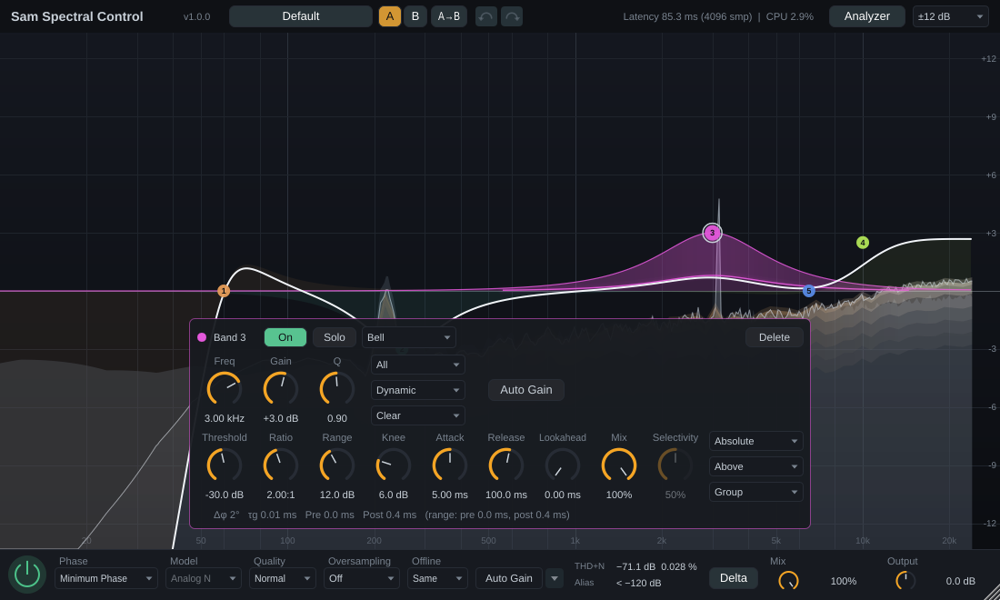
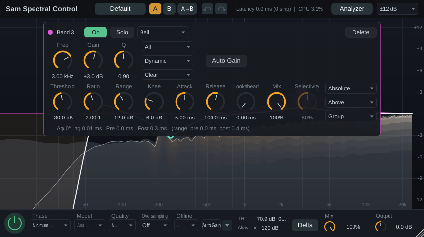

# §15 UX/UI: grupowanie, hierarchia, przyciski i animacje

Status: **przyjęta z poprawkami (§d0) i wdrożona** w etapach U1–U4 (§f); U5 w backlogu. Dotyczy wyłącznie interfejsu: bez zmian w DSP, ID parametrów, presetach i układzie stanu — doszły tylko właściwości interfejsu w stanie (otwarte panele Advanced, poziom animacji), więc bez migracji.

Pytanie: jak ułożyć interfejs Sam Spectral Control tak, żeby był dobrze pogrupowany, żeby na pierwszym planie było to, czego używa się najczęściej, jakie subtelne animacje (np. wysuwanie panelu) pomagają, jak podzielić przyciski i sekcje — z inspiracją rozwiązaniami FabFilter.

Poprawki po przeglądzie pierwszej wersji: rzadziej używane panele nie są widoczne od razu (trzy poziomy informacji, §d2); pokrętła panelu pasma zależą od tego, czy pasmo jest statyczne, dynamiczne czy spektralne (§d5); ustawienia specjalistyczne są w wysuwanych panelach **Advanced** — pasma, z boku jego panelu (§d6), i globalnym, z dolnego paska (§d8).

Makiety „przed / po” (interaktywna), system przycisków, stany panelu pasma, animacje z podglądem na żywo i oba paski: canvas [Sam Spectral Control UI](https://claude.ai/artifact/WZ3NfP5hCXpi74GYGdsSvx) (strona prywatna właściciela projektu).


## a) Literatura i normy

**Grupowanie (zasady Gestalt).**
- *Bliskość* — elementy położone blisko są odbierane jako grupa; to najsilniejsza wskazówka, potrafi przeważyć podobieństwo koloru i kształtu ([NN/g, Proximity](https://www.nngroup.com/articles/gestalt-proximity/)).
- *Podobieństwo* — elementy o tych samych cechach (kolor, kształt, rozmiar) uznajemy za powiązane; spójny styl buduje oczekiwania co do działania kontrolek ([NN/g, Similarity](https://www.nngroup.com/articles/gestalt-similarity/)).
- *Wspólny obszar* — kontener grupuje zawartość, ale ramki dodawane „na wszelki wypadek” zagracają widok; najpierw odstępy, kontener dopiero gdy odstęp nie wystarcza ([NN/g, Common Region](https://www.nngroup.com/articles/common-region/), Palmer 1992).

**Hierarchia i stopniowe odsłanianie.** Złożoność opanowuje się przewidywalnym rozmieszczeniem, wyraźną hierarchią wizualną i *progressive disclosure*: najpierw to, co potrzebne zawsze, rzadkie i zaawansowane opcje za jawnie opisaną kontrolką ([NN/g, Managing Visual Complexity](https://www.nngroup.com/videos/managing-visual-complexity/)).

**Prawa Fittsa i Hicka.** Czas trafienia rośnie z odległością i maleje z rozmiarem celu, T = a + b·log₂(2D/W) ([NN/g, Fitts's Law](https://www.nngroup.com/articles/fitts-law/)) — kontrolki edytujące obiekt powinny być blisko niego. Czas decyzji rośnie z liczbą widocznych opcji (Hick) — stąd ukrywanie rzadkich opcji, ale bez wielopoziomowych menu dla rzeczy częstych.

**Dostępność (WCAG 2.1/2.2).** Tekst ≥ 4,5:1 (1.4.3); informacja wizualna potrzebna do rozpoznania kontrolki i jej stanu (łuk wartości gałki, wskaźnik, wypełnienie przełącznika, ramka fokusu) ≥ 3:1 względem otoczenia; kontrolki nieaktywne są zwolnione, efekty hover są uzupełniające ([W3C, SC 1.4.11](https://www.w3.org/WAI/WCAG21/Understanding/non-text-contrast.html)). WCAG 2.2 SC 2.5.8 — cel kliknięcia co najmniej 24 × 24 px (poziom AA).

**Ruch w interfejsie.**
- Animacja ma służyć informacji zwrotnej, zmianie stanu i ciągłości przestrzennej, a nie rozrywce: krótka, subtelna, nienachalna ([NN/g, The Role of Animation](https://www.nngroup.com/articles/animation-purpose-ux/)). Przejścia między stanami obiektu są łatwiejsze do zrozumienia animowane niż natychmiastowe; ciągły ruch utrudnia czytanie.
- Czas: większość animacji 100–500 ms; drobna informacja zwrotna ok. 100 ms; większe zmiany ekranu (np. wysunięcie okna modalnego) 200–300 ms; najkrótszy czas, który nie jest szarpany, to dobra reguła ([NN/g, Animation Duration](https://www.nngroup.com/articles/animation-duration/)).
- Material Design: elementy wchodzące — krzywa hamująca (*decelerate*, `cubic-bezier(0, 0, 0.2, 1)`), wychodzące — przyspieszająca (`cubic-bezier(0.4, 0, 1, 1)`), wejście ok. 225 ms, wyjście ok. 195 ms, przejścia powyżej 400 ms wydają się wolne; krótsze ruchy — krótsze czasy ([Material, Duration & easing](https://m1.material.io/motion/duration-easing.html)).
- Apple HIG: ruch przekazuje stan, informację zwrotną i instrukcję ([Motion](https://developer.apple.com/design/human-interface-guidelines/motion)); przy „Ogranicz ruch” animacje dekoracyjne wyłączyć, a znaczące zastąpić przenikaniem, podświetleniem lub zmianą koloru; nie usuwać wszystkich animacji ([Reduced Motion](https://developer.apple.com/help/app-store-connect/manage-app-accessibility/reduced-motion-evaluation-criteria/)). Zaczynać od tłumienia 100 % (bez „przestrzelenia”) ([WWDC18 Designing Fluid Interfaces](https://developer.apple.com/videos/play/wwdc2018/803/)).

**Ciemny motyw.** Wyższe warstwy (panel, popover) są jaśniejsze od tła — tak w ciemnym motywie widać elewację; cienie zostają ciemne; tekst w trzech poziomach ważności ([Material, Dark theme](https://m2.material.io/design/color/dark-theme)).

**JUCE 9 (w repozytorium, `external/JUCE`).** Moduł `juce_animation`: `ValueAnimatorBuilder` (domyślnie 300 ms, `withEasing`, wywołania przy starcie/zmianie/końcu), `Animator`, `Easings` (m.in. `createCubicBezier`, `createEaseOut`, `createEaseInOut`, sprężyny), `VBlankAnimatorUpdater` taktowany odświeżaniem monitora przez `VBlankAttachment` (`juce_gui_basics`). Moduł zależy od `juce_gui_basics` i zawiera kod Chromium `cubic_bezier` (BSD-3-Clause, wg `JUCE.spdx.json`).

## b) Wtyczki referencyjne — FabFilter

Źródła: oficjalna pomoc online FabFilter i ich strona „About”; zachowania niepotwierdzone w dokumentacji oznaczono `[niezweryfikowane]`.

| # | Wzorzec | Gdzie | Co z tego bierzemy |
|---|---|---|---|
| F1 | **Wyświetlacz to interfejs.** Pasma tworzy się i edytuje bezpośrednio na wykresie; panel pasma pojawia się „tuż pod zaznaczonymi pasmami, u dołu wyświetlacza” i zmienia wszystkie zaznaczone naraz | Pro-Q 4 [Band controls](https://www.fabfilter.com/help/pro-q/using/bandcontrols), [Display](https://www.fabfilter.com/help/pro-q/using/eqdisplay); Pro-MB [Display](https://www.fabfilter.com/help/pro-mb/using/display); Saturn 2: „band controls slide underneath the selected band” ([Band controls](https://www.fabfilter.com/help/saturn/using/bandcontrols)) | panel zakotwiczony w poziomie pod węzłem; wjazd panelu jako ruch związany z miejscem |
| F2 | **Bypass pasma** w lewym górnym rogu panelu; pasmo wyłączone jest przygaszone na wykresie, a w przycisku świeci czerwona lampka; Alt-klik w kropkę przełącza bypass | Pro-Q 4 Band controls | bypass jako mała ikona z lampką, nie duży przycisk „On/Off” |
| F3 | **Solo** — przycisk ze słuchawkami, działa przy przytrzymaniu; trzymając można przeciągać częstotliwość i poziom odsłuchu | Pro-Q 4 [Solo](https://www.fabfilter.com/help/pro-q/using/solo) | ikona słuchawek; przytrzymanie = chwilowo |
| F4 | **Dynamika odsłaniana na żądanie**: pierścień zakresu wokół gałki Gain — ustawienie ≠ 0 czyni pasmo dynamicznym i *odsłania* dodatkowe kontrolki; przycisk „Expand >>” przełącza tryb automatyczny i własny (próg, attack, release); w suwaku progu widać poziom sygnału wyzwalającego; przycisk Spectral u góry pierścienia | Pro-Q 4 [Dynamic EQ](https://www.fabfilter.com/help/pro-q/using/dynamic-eq), [Spectral Dynamics](https://www.fabfilter.com/help/pro-q/using/spectral-dynamics) | tryb pasma widoczny od razu; sekcja dynamiki rozwijana; poziom detekcji przy progu |
| F5 | **Zaawansowane za przyciskiem, z sygnalizacją niedomyślnych ustawień**: przycisk Side Chain otwiera panel zaawansowany i świeci na żółto z opisem, gdy coś w nim odbiega od domyślnych | Pro-C 3 [Side chain section](https://www.fabfilter.com/help/pro-c/using/sidechainsection) | kropka „zmienione” na przycisku Advanced |
| F6 | **Panel wysuwany**: przycisk „Advanced” pod suwakiem Gain wysuwa panel z Style, Lookahead, Attack, Release, Channel Link; ponowne kliknięcie chowa | Pro-L 2 [Advanced settings](https://www.fabfilter.com/help/pro-l/using/advancedsettings) | sekcja Advanced w panelu pasma |
| F7 | **Ukryte, aż potrzebne**: źródła modulacji ukryte na starcie, „>>” pokazuje, „<<” chowa; panel slotu modulacji wyskakuje przy kontrolce docelowej | Saturn 2 [Modulation](https://www.fabfilter.com/help/saturn/using/modulation), [Slots](https://www.fabfilter.com/help/saturn/using/modulationslots) | popover przy elemencie, którego dotyczy |
| F8 | **Górny pasek**: przycisk presetu z nazwą (przygasa po zmianie parametru), strzałki poprzedni/następny, przeglądarka; Undo/Redo wyszarzone, gdy nic do cofnięcia; A/B zapamiętuje stan przed przełączeniem; Copy wyłącza się, gdy oba stany są równe | Pro-Q 4 [Loading presets](https://www.fabfilter.com/help/pro-q/presets/loadingpresets), [Undo/A-B](https://www.fabfilter.com/help/pro-q/using/undoredo) | strzałki presetów, znacznik „zmieniony”, nieaktywne Copy |
| F9 | **Dolny pasek**: tryb przetwarzania, lista instancji (środek), analizator, Character, wyjście (Auto Gain, Gain Scale, Output), zmiana rozmiaru (Mini…Extra Large, skalowanie) | Pro-Q 4 [Overview](https://www.fabfilter.com/help/pro-q/using/overview), [Output](https://www.fabfilter.com/help/pro-q/using/output), [Resize](https://www.fabfilter.com/help/pro-q/using/fullscreenandresize) | globalne ustawienia na dole, wyjście po prawej |
| F10 | **Zakres wykresu** (±3/6/12/30 dB) w prawym górnym rogu wyświetlacza | Pro-MB Display | zakres skali przy skali, nie w nagłówku |
| F11 | **Gałki**: Shift = precyzyjnie, kółko myszy, Ctrl/Cmd-klik = reset, dwuklik = wpisanie wartości („1k”, „2x”, „50%”) | Pro-Q 4 [Knobs](https://www.fabfilter.com/help/pro-q/using/knobs) | wspólne zachowanie wszystkich gałek |
| F12 | **Filozofia**: „expose the features you need, when you need them”; odejście od kopiowania sprzętu; jakość zamiast liczby funkcji | [About FabFilter](https://www.fabfilter.com/about); F. Slijkerman w [MusicRadar](https://musicradar.com/news/tech/meet-the-programmers-fabfilter-574996) | zasada nadrzędna tej propozycji |

Animacje FabFilter (płynne pojawianie się panelu pasma, przenikania) nie są opisane w dokumentacji `[niezweryfikowane]` — parametry ruchu w §d11 wynikają z wytycznych z §a, nie z pomiaru ich wtyczek.

## c) Audyt interfejsu 1.0 (przed zmianą)





| # | Problem | Fakty | Zasada |
|---|---|---|---|
| A1 | Nagłówek miesza cztery role o tej samej wadze: tożsamość, zarządzanie stanem (preset, A/B, kopiowanie, Undo/Redo), status (latencja, CPU), ustawienia widoku (Analyzer, zakres EQ) | brak przerw i separatorów między rolami | bliskość, hierarchia |
| A2 | Dolny pasek: 11 kontrolek w jednym rzędzie bez grup; Offline (rzadkie) i Model (aktywny tylko w Analog Feel) zajmują miejsce na równi z Phase i Quality | przy 860 px etykiety się ucinają: „Minimum …”, „Ana…”, „N…”, „…”, „THD…” | Hick, bliskość |
| A3 | Mix i Output to gałki ok. 20 px, a wartość jest 40 px dalej | mały cel, rozdzielona etykieta | Fitts |
| A4 | Panel pasma jest zawsze wyśrodkowany na wykresie, niezależnie od położenia węzła; gdy zasłania węzeł, przeskakuje do góry bez animacji | panel Dynamic ma 684 × 232 px — ok. 25 % pola wykresu przy 1100 × 660; w oknie 860 × 480 zasłania większość krzywej | Fitts, ciągłość |
| A5 | Pierwszy rząd panelu łączy tożsamość pasma, przełączniki stanu, kształt i destrukcyjne „Delete” — wszystkie jako przyciski tej samej wagi | Delete obok Shape, bez potwierdzenia (na szczęście z Undo) | hierarchia, ochrona przed błędem |
| A6 | Tryb pasma (Static / Dynamic / Spectral) — kluczowa decyzja — jest w trzeciej, niepodpisanej liście rozwijanej; listy Target, Mode, Character nie mają etykiet | „All”, „Static”, „Clear” bez podpisu | widoczność stanu |
| A7 | Rząd dynamiki: 9 gałek o identycznym rozmiarze i kolorze + 3 niepodpisane listy (Absolute / Above / Group) | Knee, Lookahead, Mix, Link, Selectivity zawsze widoczne | progressive disclosure |
| A8 | Wszystkie gałki są pomarańczowe (akcent), a kolor pasma występuje tylko w kropce i ramce | słabe powiązanie panel ↔ węzeł | podobieństwo |
| A9 | Tor gałki i obramowania list mają kontrast 1,24:1 do panelu; gałka na 0 (np. Lookahead 0 ms) wygląda jak sama kreska | `panelEdge #272c35` na `panel #171a20` | WCAG 1.4.11 (wskaźnik stanu ma 3:1, zakres gałki ginie) |
| A10 | Tekst pomocniczy (`textDim #79838f`) ma 4,53:1 do panelu — na granicy AA | — | WCAG 1.4.3 |
| A11 | Max Lookahead nie ma kontrolki w interfejsie (tylko parametr hosta i automatyczne podnoszenie) | — | wykrywalność |
| A12 | Brak animacji: panel pojawia się i znika skokowo, zmiana trybu zmienia jego wysokość skokowo, przeskok góra/dół | — | ciągłość zmian stanu (NN/g) |
| A13 | Brak wskaźnika zmienionego presetu, strzałek poprzedni/następny, nieaktywnego „A→B” przy równych stanach | — | F8 |
| A14 | Brak przycisku pomocy i ustawień interfejsu (rozmiar, animacje) | — | F8, F9 |

## d) Propozycja (po poprawkach) i jej wdrożenie

### d0. Poprawki po przeglądzie (2026-10-09)

| # | Pierwsza wersja | Po poprawce | Powód |
|---|---|---|---|
| P1 | dwa plany zawsze widoczne, trzeci w rozwijanej sekcji panelu i w szufladzie ⚙ | trzy poziomy (§d2): **zawsze** · **na żądanie** (panel wybranego pasma) · **zaawansowane** (za przyciskiem Advanced) | rzadziej używane panele nie zajmują miejsca, dopóki nie są potrzebne |
| P2 | sekcja Dynamics z pięcioma gałkami, Selectivity zamiast Lookahead w trybie Spectral | zestaw gałek zależy od trybu pasma: Static — tylko EQ; Dynamic — Threshold, Ratio, Range, Attack, Release; Spectral — Threshold, Selectivity, Range, Attack, Release (§d5) | każdy tryb pokazuje to, czym się go ustawia |
| P3 | sekcja Advanced rozwijana wewnątrz panelu (panel rośnie) | **wysuwany panel Advanced pasma** obok panelu: Threshold Mode, Direction, Knee, Lookahead (Dynamic) albo Ratio (Spectral), Mix, Link i odczyty (§d6) | panel pasma ma dwie stałe wysokości; szczegóły tylko na żądanie |
| P4 | Quality i Oversampling w dolnym pasku, Offline i Max Lookahead w szufladzie ⚙, mierniki w pasku | **globalny panel Advanced** wysuwany z dolnego paska: Quality, Oversampling, Offline, Max Lookahead, Auto Gain (ważenie, szybkość), mierniki THD+N i aliasingu (§d8) | to ustawienia „raz na sesję”; w pasku zostaje to, co zmienia się często |
| P5 | odczyty pasma w stopce panelu | odczyty w panelu Advanced pasma; ostrzeżenie (słyszalny ringing) zostawia kropkę na przycisku Advanced | informacja specjalistyczna, a ostrzeżenie nadal widać |
| P6 | ⚙ = szuflada z ustawieniami przetwarzania i interfejsu | ⚙ = tylko interfejs (animacje, rozmiar okna); ? = instrukcja, mysz i klawiatura, informacje o wtyczce | jedno miejsce na każdy rodzaj ustawień |

### d1. Zasady

1. **Wykres jest interfejsem.** Największa powierzchnia i najwyższy kontrast należą do krzywej i węzłów; wszystko inne jej służy i zasłania ją jak najmniej.
2. **Trzy poziomy informacji** (§d2): to, czego używa się w każdej sesji, jest widoczne; to, co dotyczy jednego pasma, pojawia się przy nim, gdy się je wybierze; ustawienia specjalistyczne czekają za jawnie podpisanym przyciskiem **Advanced**.
3. **Treść zależna od kontekstu.** Panel pasma pokazuje tylko kontrolki, które w trybie pasma coś robią (żadnych wyszarzonych gałek Lookahead w Spectral czy Selectivity w Dynamic).
4. **Grupy przez odstęp, kontener tylko dla warstwy.** Grupy w paskach oddziela odstęp 16–24 px i cienka linia; ramkę ma tylko to, co leży nad wykresem (panel pasma, panel Advanced, menu).
5. **Edycja przy obiekcie.** Panel pasma pojawia się pod jego węzłem, a jego Advanced tuż obok; menu wyrasta z przycisku, który je otworzył.
6. **Jeden przycisk = jeden typ** (§d9); ten sam stan wygląda wszędzie tak samo.
7. **Ruch tylko dla ciągłości i informacji zwrotnej** (§d11): 110–200 ms, bez odbić, zawsze przerywalny; krzywa nigdy nie „goni” dźwięku.
8. **Widać, że coś odbiega od domyślnego.** Ukryte ustawienie różne od domyślnego, podpowiedź albo ostrzeżenie zostawia kropkę na przycisku, który je odsłania (F5).

### d2. Poziomy informacji

| Poziom | Kiedy widoczny | Zawartość |
|---|---|---|
| 1. Zawsze | cały czas | nagłówek: presety `‹ nazwa • ›`, `A \| B`, kopiowanie, Undo/Redo, latencja i CPU, Analyzer, ⚙, ?; wykres z węzłami i zakresem skali; dolny pasek: ⏻, Phase (+ Model w Analog Feel), Advanced, Delta, Auto Gain, Mix, Output |
| 2. Na żądanie | po wybraniu pasma | panel pasma pod węzłem: tryb, kształt, nachylenie, Freq, Gain, Q, Target, Character (Speakers w surround), bypass, solo, menu ⋯; w trybach Dynamic i Spectral rząd dynamiki zależny od trybu i Auto Gain pasma |
| 3. Zaawansowane | po kliknięciu **Advanced** | panel Advanced pasma (z boku panelu pasma), globalny panel Advanced (nad dolnym paskiem), menu ⚙ |

Stan otwarcia obu paneli Advanced i poziom animacji zapisują się z sesją (`uiBandAdvanced`, `uiGlobalAdvanced`, `uiMotion` w stanie, jak rozmiar okna) — kto używa paneli Advanced, nie musi ich otwierać za każdym razem.

### d3. Strefy okna

```
┌───────────────────────────────────────────────────────────────────────────────────────────┐
│ Sam Spectral Control v1.0 │ ‹ Default • › │ A|B ⧉ │ ↶ ↷ │  Latency 85,3 ms · CPU 3 % │ Analyzer▾ ⚙ ? │  nagłówek 40 px
├───────────────────────────────────────────────────────────────────────────────────────────┤
│                                                                             ±12 dB ▾      │  zakres przy skali (F10)
│                          ●2        ●3                                              ●4     │
│     ╭ ● Band 3 [Static|Dynamic|Spectral] Advanced › ⏻ 🎧 ⋯ ╮ ╭ Threshold   Direction ╮      │  panel pasma pod węzłem;
│     │ Shape   ◯Freq ◯Gain ◯Q    Target                    │ │ ◦Knee ◦Lookahead ◦Mix  │      │  Advanced pasma wysuwa
│     │ Slope                     Character                 │ │ Link ▾                 │      │  się spod jego krawędzi
│     │ DYNAMICS ─────────────────────────────── [Auto Gain] │ │ odczyty                │      │
│     │ ◯Threshold ◯Ratio ◯Range ◯Attack ◯Release           │ ╰────────────────────────╯      │
│     ╰─────────────────────────────────────────────────────╯                                 │
├───────────────────────────────────────────────────────────────────────────────────────────┤  ↑ globalny Advanced 84 px:
│ PROCESSING Quality Oversampling Offline ◯Max Lookahead │ AUTO GAIN Weighting Speed │ METERS │    wysuwa się zza paska
├───────────────────────────────────────────────────────────────────────────────────────────┤
│ ⏻ │ Phase ▾ (Model ▾) │ Advanced ▴•          Delta  Auto Gain −1,2 dB │ ◯ Mix   ◯ Output │  dolny pasek 56 px
└───────────────────────────────────────────────────────────────────────────────────────────┘
```

### d4. Nagłówek (40 px)

Od lewej, grupy oddzielone odstępem 16 px i linią 1 px:

1. **Tożsamość**: nazwa (15 px, półgruba) i wersja (11,5 px, podpis); przy oknie < 1000 px sama nazwa.
2. **Presety**: `‹` *pole z nazwą* `›`. Strzałki wczytują poprzedni / następny preset w kolejności menu (fabryczne, potem użytkownika). Gdy ustawienia różnią się od wczytanego presetu, nazwa przygasa i dostaje bursztynową kropkę (F8; porównanie wszystkich parametrów brzmienia i głośników 4 razy na sekundę, bez Bypass i Delta). Kliknięcie pola — menu presetów jak w 1.0.
3. **Porównanie i historia**: segmented `A | B`, ikona kopiowania `⧉` (nieaktywna, gdy oba stany są równe — także przed pierwszym przełączeniem, bo B zaczyna jako kopia A), `↶ ↷` (nieaktywne, gdy nie ma czego cofnąć; w podpowiedzi nazwa kroku).
4. **Status i widok** (do prawej): chip „Latency 85,3 ms · CPU 2,7 %” (przy < 1000 px „85,3 ms · 2,7 %”; w podpowiedzi latencja w próbkach i współczynnik oversamplingu; przy zmianie latencji chip świeci na bursztynowo przez 3 s), split button **Analyzer ▾** (lewa część włącza i wyłącza widmo, ▾ otwiera jego ustawienia), **⚙** (animacje Full / Reduced / Off, rozmiary okna Small 860 × 480 … Extra Large 1800 × 1080), **?** (instrukcja — zainstalowany `Manual.md`, mysz i klawiatura, informacje o wtyczce).

Zakres skali EQ jest w prawym górnym rogu wykresu, obok skali dB (F10). Progi ostrzeżeń mierników przeszły z menu Analyzer do kliknięcia w mierniki (§d8).

### d5. Panel pasma: pokrętła zależne od trybu

| | Static | Dynamic | Spectral |
|---|---|---|---|
| Nagłówek | kropka w kolorze pasma i „Band *n*”; tryb **Static \| Dynamic \| Spectral**; **Advanced ›**; ⏻ (czerwona lampka, gdy pasmo wyłączone); 🎧 (klik — zatrzaśnięcie, przytrzymanie — chwilowo); ⋯ (Copy, Paste, Reset, Delete) | jak Static | jak Static |
| Rząd EQ | Shape, Slope (cięcia, półki, Band Pass), **Freq**, **Gain**, **Q**, Target, Character; w surround Speakers | jak Static | jak Static |
| Rząd dynamiki | — | **Threshold**, **Ratio**, **Range**, **Attack**, **Release** + Auto Gain pasma | **Threshold**, **Selectivity**, **Range**, **Attack**, **Release** + Auto Gain pasma |
| Advanced pasma (§d6) | odczyty: faza nadmiarowa, opóźnienie grupowe, ringing | Threshold Mode, Direction, Knee, **Lookahead**, Mix, Link; odczyty (także przy pełnym Range) | Threshold Mode, Direction, Knee, **Ratio**, Mix, Link; pre-echo STFT |

- **Wymiary**: szerokość 488 px (600 px w surround, z Speakers), wysokość 132 px (Static) albo 232 px (Dynamic, Spectral). Przy zmianie trybu panel zmienia tylko wysokość, nigdy szerokości (w 1.0 skakał z 482 na 684 px).
- **Gałki**: EQ ok. 46 px, dynamika ok. 38 px, Advanced ok. 32 px; łuk w kolorze pasma (podobieństwo z węzłem, A8), Gain od 0 dB w obie strony; podpis nad gałką, wartość pod nią (kliknięcie — wpisanie wartości, dwuklik — wartość domyślna).
- **Tryb**: segmenty Dynamic i Spectral są nieaktywne dla kształtów bez wzmocnienia (podpowiedź mówi dlaczego). Przełączenie na Spectral z nieruszonym progiem Dynamic ustawia Relative +6 dB i odwrotnie (DYN-4, bez zmian).
- **Liczba kontrolek parametrów**: Static 8 (w 1.0: 11–12 kontrolek, w tym 3 listy bez podpisu), Dynamic i Spectral 14 (w 1.0: 23–24), w 1.1.0 — 15, bo kierunek **Down | Up** (kompresja w górę) przeszedł z Advanced do panelu pasma: to wybór tego, co pasmo robi, a nie szczegół detektora. Test `TestInterface` sprawdza, które parametry ma każdy tryb.

### d6. Wysuwany panel Advanced pasma

- Otwiera go przycisk **Advanced ›** w nagłówku panelu pasma (ten sam przycisk, teraz **‹**, zamyka). Szerokość 248 px, wysokość jak panel pasma, warstwa 2 (`#232831`), obrys w kolorze pasma.
- **Ruch**: wysuwa się spod krawędzi panelu pasma (160–180 ms, krzywa wejścia lub standard, przenikanie 140 ms), chowa się pod nią z powrotem (140 ms, wyjście). *Reduced*: samo przenikanie ≤ 100 ms; *Off*: natychmiast.
- **Strona**: domyślnie z prawej; jeśli tam zasłaniałby węzeł, otwiera się z lewej (§d7).
- **Zawartość** wg trybu (§d5). Odczyty w dwóch kolumnach (nazwa — wartość); wartości ringingu i pre-echo bursztynowe, gdy mogą być słyszalne (post > 50 ms albo pre > 5 ms przy −60 dB, §12c). Pasmo Static widzi same odczyty i notkę, że ustawienia detektora mają pasma Dynamic i Spectral.
- **Kropka na Advanced** (bursztynowa, F5): ustawienie detektora różne od domyślnego **dla trybu pasma** (Threshold Mode: Absolute w Dynamic, Relative w Spectral; Lookahead liczy się tylko w Dynamic, Ratio w panelu Advanced — tylko w Spectral) albo odczyt ostrzegający przed ringingiem. Podpowiedź przycisku mówi, co jest przyczyną.

### d7. Dokowanie panelu pasma

Czysta funkcja `dockBandPanel` (`ui/PanelLayout`, test E6) sprawdza kandydatów w kolejności:

1. u dołu wykresu (nad skalą częstotliwości albo nad otwartym globalnym panelem Advanced), środek panelu = x węzła, Advanced z prawej;
2. to samo z Advanced z lewej;
3. u góry wykresu (Advanced z prawej, potem z lewej);
4. obok węzła — para panel + Advanced w całości na prawo albo na lewo od niego;
5. gdy nic nie odsłania węzła (wysoki panel w niskim oknie) — pozycja, która zasłania go najmniej.

Margines 8 px od krawędzi wykresu, węzeł co najmniej 12 px od panelu. Podczas przeciągania węzła panel stoi; po puszczeniu przesuwa się w nowe miejsce (180 ms). W oknie 1100 × 660 węzeł nie jest zasłonięty w żadnym położeniu (test: siatka 41 × 31 położeń, panel Static i Dynamic, z Advanced pasma i bez, z globalnym Advanced bez Advanced pasma). W oknie minimalnym 860 × 480 pasmo Dynamic na 0 dB w środku wykresu z otwartym Advanced pasma bywa zasłonięte — panel staje wtedy tam, gdzie zasłania najmniej.

### d8. Dolny pasek i globalny panel Advanced

**Dolny pasek** (56 px), grupy: **⏻** | **Phase** (+ **Model** tylko w Analog Feel) | **Advanced ▴** | … | **Delta**, **Auto Gain** | **Mix**, **Output**.

- Phase i Model to *value buttons* (podpis nad wartością, ▾ tuż za wartością); przy < 1000 px krótkie nazwy (Minimum / Natural / Analog). Koszt trybów w podpowiedzi (PH-2).
- **Advanced ▴** przełącza globalny panel. Kropka: bursztynowa — ustawienie różne od domyślnego (lista w podpowiedzi, np. „Quality High, Offline 8x”) albo podpowiedź oversamplingu (OS-5); czerwona — miernik ponad progiem ostrzeżenia (MTR-4). Ostrzeżenia nie giną więc, gdy panel jest zamknięty.
- **Delta** w stanie włączonym bursztynowa (słyszysz coś innego niż normalny tor). **Auto Gain** zielony, gdy włączony, z bieżącą korekcją na przycisku („Auto Gain −1,2 dB”; dawniej w linii stanu).
- **Mix** i **Output**: gałka 36 px z podpisem i wartością obok (Fitts, A3); Output od 0 dB w obie strony.

**Globalny panel Advanced** (84 px, na całą szerokość okna) wysuwa się zza dolnego paska (200 ms, krzywa wejścia; chowa się w 150 ms); panel pasma dokuje wtedy nad nim, a skala częstotliwości wykresu przesuwa się nad jego krawędź.

| Grupa | Kontrolki |
|---|---|
| Processing | **Quality** (koszt i latencja w podpowiedzi), **Oversampling** (przy podpowiedzi OS-5 bursztynowy podpis „Oversampling ▴” i powód), **Offline** (render), **Max Lookahead** (gałka; dotąd tylko parametr hosta, A11) |
| Auto Gain | **Weighting**, **Speed** (dotąd menu ▾ przy przycisku Auto Gain) |
| Meters | THD+N i aliasing (MTR-1, MTR-4); kliknięcie — progi ostrzeżeń (dotąd w menu Analyzer) |

Odczyty mierników odświeżają się także przy zamkniętym panelu (kropka na Advanced).

### d9. System przycisków

| Typ (klasa) | Kiedy | Wygląd | Przykłady |
|---|---|---|---|
| **Chip** (`ChipButton`) | włącza / wyłącza funkcję albo panel | obrys; *on*: wypełnienie w kolorze semantycznym; może mieć ikonę (›, ▴) i kropkę | Auto Gain, Delta, Analyzer, Advanced |
| **Ikona** (`IconButton`) | akcje i stany elementu | 28 × 28 px, tło tylko na hover; *on*: ikona i tło w kolorze stanu; lampka/kropka w rogu | ‹ ›, ⧉, ↶ ↷, ⚙, ?, ⋯, ⏻ pasma (czerwona lampka), 🎧 (bursztyn) |
| **Segmented** (`SegmentedControl`) | 2–3 wykluczające się opcje | wspólny kontener, przesuwany wskaźnik (140 ms), strzałki ← → z klawiatury, nieaktywne segmenty pomijane | A \| B, Static \| Dynamic \| Spectral, Absolute \| Relative, Down \| Up |
| **Value button** (`ValueButton`, `ChoiceParameterButton`, `BandChoiceButton`) | wybór z listy, zmieniany rzadziej | podpis 11 px nad wartością, ▾ tuż za wartością, bez ramki; menu pod przyciskiem | Phase, Model, Quality, Oversampling, Offline, Weighting, Speed, Shape, Slope, Target, Character, Link, zakres EQ |
| **Split button** | funkcja + jej ustawienia | dwa chipy połączone krawędzią | Analyzer ▾ |
| **Pole presetu** (`PresetNameButton`) | nazwa i menu presetów | pole z obrysem, kropka „zmieniony” | Default • |
| **Destrukcyjny** | usuwanie | tylko w menu (czerwony tekst) i klawiszem Delete | Delete Band, Delete preset |

**Stany** (wszystkie typy): domyślny; hover (tło +6 % jasności tekstu); wciśnięty (+12 %); fokus klawiatury (pierścień 2 px; kliknięcie myszą nie zabiera fokusu wykresowi, więc jego skróty działają dalej); nieaktywny (krycie ok. 40 %, bez hover, podpowiedź wyjaśnia dlaczego); *on* (wypełnienie); *niedomyślny / uwaga* (kropka 7 px w prawym górnym rogu).

**Kolory semantyczne**: kolor pasma = tożsamość pasma (kropka, obrys paneli, łuki gałek); bursztyn `#f5a524` = słyszysz coś innego niż normalny tor albo uwaga (Solo, Delta, kropki, podpowiedź oversamplingu, zmiana latencji); zielony = przetwarzanie włączone (⏻, Auto Gain); czerwony = pasmo wyłączone (lampka), miernik ponad progiem; neutralny jasny = panel otwarty / widmo włączone. Kolor zawsze idzie w parze z kształtem lub tekstem.

### d10. Tokeny wizualne

| Token | Wartość | Kontrast do panelu `#1b1f26` / warstwy 2 `#232831` |
|---|---|---|
| tło okna, nagłówek | `#0f1115` | — |
| wykres | `#151820` → `#0c0e12` | — |
| panel, dolny pasek, globalny Advanced (warstwa 1) | `#1b1f26` | — |
| Advanced pasma, menu, podpowiedzi (warstwa 2) | `#232831` | — |
| wybrany segment, korpus gałki | `#323945` | dekoracyjny |
| linie podziału | `#2b313b` | dekoracyjne |
| obrysy kontrolek, tor gałki | `#4f5864` | 2,29 / 2,05 (dawniej 1,24) |
| tekst | `#e6ebf0` | 13,8 / 12,3 |
| wartości | `#a3adb8` | 7,3 / 6,5 |
| podpisy | `#8a94a0` | 5,4 / 4,8 (dawniej 4,5 na granicy AA) |
| akcent (bursztyn) | `#f5a524` | 8,1 / 7,3 |
| lampka bypass | `#ff5c5c` | 5,5 / 4,9 |
| kolory pasm (łuki gałek) | HSL (złoty kąt, 72 %, 62 %) | ≥ 3,17 (24 kolory) |

Kontrasty liczy funkcja `contrastRatio` (wzór WCAG), a test E3 pilnuje progów. Typografia: czcionka systemowa (pytanie g3 otwarte), rozmiary 10,5 / 11 / 12 / 13 / 15 px. Siatka 4 px; promienie 5 px (kontrolki) i 9 px (panele).

### d11. Animacje

Krzywe: *wejście* `cubic-bezier(0, 0, 0.2, 1)`, *wyjście* `cubic-bezier(0.4, 0, 1, 1)`, *standard* `cubic-bezier(0.2, 0, 0, 1)`.

| # | Zdarzenie | Animacja | Czas | Krzywa | *Reduced* |
|---|---|---|---|---|---|
| 1 | pojawienie się panelu pasma | przenikanie + 8 px od strony węzła | 160 ms | wejście | przenikanie 100 ms |
| 2 | zniknięcie panelu pasma (i jego Advanced) | przenikanie | 110 ms | wyjście | przenikanie 100 ms |
| 3 | inne pasmo, dół ↔ góra, zmiana trybu (wysokość) | przesunięcie i rozmiar | 180 ms | standard | natychmiast |
| 4 | Advanced pasma: otwarcie / zamknięcie | wysunięcie spod panelu + przenikanie | 160–180 ms (przenikanie 140 ms) / 140 ms | wejście, standard / wyjście | przenikanie ≤ 100 ms |
| 5 | globalny Advanced: otwarcie / zamknięcie | wysunięcie zza dolnego paska + przenikanie | 200 ms (przenikanie 120 ms) / 150 ms | wejście / wyjście | przenikanie ≤ 100 ms |
| 6 | segmented (tryb, A/B, Abs/Rel, Down/Up) | przesunięcie wskaźnika | 140 ms | standard | natychmiast |
| 7 | zmiana latencji | bursztynowy chip statusu przez 3 s | — | — | bez zmian |

*Off* = wszystko natychmiast. Reguły z pierwszej wersji zostają: krzywa i wartości nigdy nie są animowane (rysowane od razu), każda animacja startuje od bieżącej wartości i nie blokuje wejścia, bez odbić i pętli.

**Implementacja** (`ui/Motion`): własna krzywa Béziera (Newton z bisekcją, kilkadziesiąt linii, bez kodu zewnętrznego — `juce_animation` wniósłby kod Chromium `cubic_bezier` na licencji BSD-3), `Tween` z przerwaniem w dowolnej chwili i `ComponentMotion` (pozycja, rozmiar, krycie) taktowany zegarem 60 Hz **tylko w trakcie ruchu** — bez ruchu zero wywołań na klatkę. Zegar zamiast `VBlankAttachment`, bo działa też bez okna na ekranie (`ssc_screenshot`, testy); przy 60 Hz różnica jest niezauważalna. Poziom (Full / Reduced / Off) wybiera się w ⚙ i zapisuje w stanie; odczyt systemowego „ogranicz ruch” (macOS, Windows) — backlog (g6).

### d12. Gdzie trafił każdy element 1.0

| W 1.0 | Teraz | Poziom |
|---|---|---|
| Preset (nagłówek) | `‹` nazwa `•` `›` | 1 |
| A, B, A→B | `A \| B` + `⧉` (nieaktywny przy równych stanach) | 1 |
| Undo, Redo | ikony | 1 |
| Linia statusu (Auto Gain, OS, latencja, CPU) | chip „Latency · CPU” (próbki i OS w podpowiedzi); korekcja Auto Gain na przycisku Auto Gain | 1 |
| Analyzer (menu z podmenu) | split button: przełącznik + menu ▾ | 1 |
| Zakres EQ (nagłówek) | prawy górny róg wykresu | 1 |
| On / Off, Solo, Delete pasma | ⏻ z lampką, 🎧, menu ⋯ (i klawisz Delete) | 2 |
| Shape, Slope (listy) | value buttons z podpisem w rzędzie EQ | 2 |
| Mode (lista) | segmented w nagłówku panelu | 2 |
| Target, Character (listy bez podpisu) | value buttons z podpisem | 2 |
| Auto Gain pasma | przełącznik w nagłówku sekcji dynamiki | 2 |
| Threshold, Range, Attack, Release | rząd dynamiki | 2 |
| Ratio | rząd dynamiki w Dynamic; Advanced pasma w Spectral | 2 / 3 |
| Selectivity | rząd dynamiki tylko w Spectral | 2 |
| Threshold Mode, Direction, Knee, Mix, Link | Advanced pasma | 3 |
| Lookahead | Advanced pasma, tylko w Dynamic | 3 |
| Odczyty pasma | Advanced pasma (ostrzeżenie: kropka na Advanced) | 3 |
| Phase, Model | dolny pasek (Model tylko w Analog Feel) | 1 |
| Quality, Oversampling, Offline | globalny Advanced | 3 |
| Auto Gain ▾ (ważenie, szybkość) | globalny Advanced | 3 |
| Mierniki THD+N i aliasingu | globalny Advanced (ostrzeżenie: kropka na Advanced) | 3 |
| Progi mierników (menu Analyzer) | kliknięcie w mierniki | 3 |
| Max Lookahead (tylko w hoście) | globalny Advanced | 3 |
| Delta, Mix, Output | dolny pasek | 1 |
| — | ⚙ (animacje, rozmiar okna), ? (instrukcja, mysz i klawiatura, informacje) | 3 / 1 |

## e) Kryteria akceptacji i wyniki

| # | Kryterium | Sprawdzenie | Wynik |
|---|---|---|---|
| E1 | Grupy w paskach oddzielone ≥ 16 px i linią; sekcje paneli podpisane | zrzuty `ssc_screenshot` | spełnione (`editor.png`, `editor-advanced.png`) |
| E2 | Panel pasma pokazuje tylko parametry swojego trybu: Static ≤ 11, Dynamic i Spectral ≤ 14 kontrolek parametrów (w 1.1.0 ≤ 15: Down \| Up); żadnej listy bez podpisu | test `TestInterface` | spełnione: 8 i 15 |
| E3 | Tekst ≥ 4,5:1 do swojej warstwy; wskaźniki stanu ≥ 3:1; tor gałki ≥ 2:1 | test tokenów (`contrastRatio`) | spełnione (§d10) |
| E4 | Cele kliknięcia ≥ 24 × 24 px | przegląd, test segmentów | przyciski 28 × 28, segmenty i chipy wysokie na 26–28 px |
| E5 | Przy 860 × 480 żadna etykieta nie jest ucięta | zrzut `editor-860x480.png` | spełnione (krótkie nazwy trybów fazy, zwarty chip statusu) |
| E6 | Panel nigdy nie zasłania zaznaczonego węzła; środek panelu = x węzła (± przycięcie) | test `dockBandPanel` (siatka położeń) | spełnione w oknie 1100 × 660; wyjątek okna minimalnego opisany w §d7 |
| E7 | Animacje „ramy” 110–200 ms, przerywalne, bez blokowania wejścia; *Reduced* i *Off* działają | testy krzywych (zgodność z próbkowaniem Béziera do 2·10⁻⁴), `Tween`, `ComponentMotion` | spełnione; ustawienie systemowe — backlog (g6) |
| E8 | Koszt rysowania nie wyższy niż w 1.0 o > 10 %; bez animacji brak wywołań na klatkę | `ssc_screenshot profile=` przed/po | spełnione: mediana z 3 przebiegów po 300 klatek (1100 × 660, pasmo Dynamic, analizator Pre + Post): 1.0 — 9,0 ms (p95 13,0 ms); teraz, panele Advanced zamknięte — 8,1 ms (p95 11,7 ms, −10 %); oba panele Advanced otwarte — 9,8 ms (p95 14,1 ms, +9 %). Zegar ruchu działa tylko w trakcie animacji |
| E9 | Max Lookahead i Offline osiągalne w ≤ 2 kliknięciach | przegląd | spełnione: Advanced ▴ → kontrolka (i jedno więcej na wybór z listy) |
| E10 | Fokus klawiatury widoczny; kliknięcie nie zabiera fokusu wykresowi | przegląd | pierścień fokusu w nowych kontrolkach; pełna kolejność Tab — test ręczny w hostach (TST-3) |

## f) Wdrożenie

| Etap | Zakres | Stan |
|---|---|---|
| U1 Tokeny i przyciski | tokeny (§d10), `ChipButton`, `IconButton`, `SegmentedControl`, `ValueButton`, kropki, pierścień fokusu, test kontrastu | zrobione |
| U2 Paski | nagłówek (presety ‹ › i kropka, A \| B, nieaktywne kopiowanie, chip statusu, split Analyzer, ⚙, ?), zakres EQ przy wykresie, dolny pasek, **globalny Advanced** | zrobione |
| U3 Panel pasma | tryb w nagłówku, **pokrętła zależne od trybu**, **Advanced pasma**, dokowanie przy węźle (`dockBandPanel` + test), menu ⋯, solo klik / przytrzymanie | zrobione |
| U4 Ruch | `ui/Motion`, animacje z §d11, *Full / Reduced / Off* | zrobione (bez odczytu ustawienia systemowego) |
| U5 Popovery i informacja zwrotna | popover analizatora zamiast menu, popover kształtów z ikonami, łuk poziomu detekcji przy Threshold (telemetria z silnika), łuk bieżącej zmiany na gałce Gain, przejścia krzywej przy presecie / A/B | backlog |

Kod: `src/ui/Motion`, `Controls`, `PanelLayout` (nowe), `BandPanel` (`BandKnob`, `BandChoiceButton`, `BandPanel`, `BandAdvancedPanel`), `ControlBar` (`ControlBar`, `GlobalAdvancedPanel`, `ParameterKnob`), `PresetBar`, `PluginEditor`; `plugin/Presets` (`PresetComparison`, `otherComparePreset`). Testy: `tests/plugin/TestInterface.cpp`. Zrzuty: `ssc_screenshot … advanced=1 globaladvanced=1 motion=0|1|2`.

## g) Decyzje i pytania

1. **Skróty jak w FabFilter?** Bez zmian: Alt + przytrzymanie węzła = Solo, dwuklik = bypass. Przycisk 🎧 w panelu działa jak w FabFilter (klik zatrzaskuje, przytrzymanie — chwilowo). Otwarte: Alt-klik = bypass.
2. **Rozmiar okna**: zostaje swobodne skalowanie; doszły rozmiary Small / Medium / Large / Extra Large w ⚙. Rozstrzygnięte.
3. **Czcionka**: zostaje systemowa. Otwarte (IBM Plex wymagałby wpisu w `THIRD-PARTY-NOTICES.txt`).
4. **Odczyty w panelu**: rozstrzygnięte — w panelu Advanced pasma (poziom 3), ostrzeżenie jako kropka na przycisku.
5. **Pierścień zakresu wokół Gain**: zostaje gałka Range; łuk bieżącej zmiany na Gain w backlogu (U5).
6. **Systemowe „ogranicz ruch”** (macOS `accessibilityDisplayShouldReduceMotion`, Windows `SPI_GETCLIENTAREAANIMATION`): backlog; do tego czasu wybór w ⚙.

## Źródła

- FabFilter Pro-Q 4 Help: [Overview](https://www.fabfilter.com/help/pro-q/using/overview), [Band controls](https://www.fabfilter.com/help/pro-q/using/bandcontrols), [Display and workflow](https://www.fabfilter.com/help/pro-q/using/eqdisplay), [Dynamic EQ](https://www.fabfilter.com/help/pro-q/using/dynamic-eq), [Spectral Dynamics](https://www.fabfilter.com/help/pro-q/using/spectral-dynamics), [Solo](https://www.fabfilter.com/help/pro-q/using/solo), [Knobs](https://www.fabfilter.com/help/pro-q/using/knobs), [Output options](https://www.fabfilter.com/help/pro-q/using/output), [Full Screen, resizing and scaling](https://www.fabfilter.com/help/pro-q/using/fullscreenandresize), [Undo, redo, A/B](https://www.fabfilter.com/help/pro-q/using/undoredo), [Loading presets](https://www.fabfilter.com/help/pro-q/presets/loadingpresets)
- FabFilter Pro-C 3 Help: [Side chain section](https://www.fabfilter.com/help/pro-c/using/sidechainsection), [Dynamics controls](https://www.fabfilter.com/help/pro-c/using/dynamicscontrols); Pro-L 2 Help: [Advanced settings](https://www.fabfilter.com/help/pro-l/using/advancedsettings); Pro-MB Help: [Display](https://www.fabfilter.com/help/pro-mb/using/display); Saturn 2 Help: [Band controls](https://www.fabfilter.com/help/saturn/using/bandcontrols), [Modulation](https://www.fabfilter.com/help/saturn/using/modulation), [Modulation slots](https://www.fabfilter.com/help/saturn/using/modulationslots)
- [About FabFilter](https://www.fabfilter.com/about); [MusicRadar: Meet the programmers — FabFilter](https://musicradar.com/news/tech/meet-the-programmers-fabfilter-574996)
- NN/g: [Proximity](https://www.nngroup.com/articles/gestalt-proximity/), [Similarity](https://www.nngroup.com/articles/gestalt-similarity/), [Common Region](https://www.nngroup.com/articles/common-region/), [Managing Visual Complexity](https://www.nngroup.com/videos/managing-visual-complexity/), [Fitts's Law](https://www.nngroup.com/articles/fitts-law/), [The Role of Animation and Motion in UX](https://www.nngroup.com/articles/animation-purpose-ux/), [Animation Duration](https://www.nngroup.com/articles/animation-duration/)
- W3C: [Understanding SC 1.4.11 Non-text Contrast](https://www.w3.org/WAI/WCAG21/Understanding/non-text-contrast.html), [Understanding SC 1.4.3 Contrast (Minimum)](https://www.w3.org/WAI/WCAG21/Understanding/contrast-minimum.html)
- Apple: [HIG Motion](https://developer.apple.com/design/human-interface-guidelines/motion), [Reduced Motion evaluation criteria](https://developer.apple.com/help/app-store-connect/manage-app-accessibility/reduced-motion-evaluation-criteria/), [WWDC18 Designing Fluid Interfaces](https://developer.apple.com/videos/play/wwdc2018/803/)
- Material Design: [Duration & easing](https://m1.material.io/motion/duration-easing.html), [Dark theme](https://m2.material.io/design/color/dark-theme)
- JUCE 9: `external/JUCE/modules/juce_animation` (`juce_ValueAnimatorBuilder.h`, `juce_Easings.h`, `juce_VBlankAnimatorUpdater.h`), `juce_gui_basics/windows/juce_VBlankAttachment.h`
