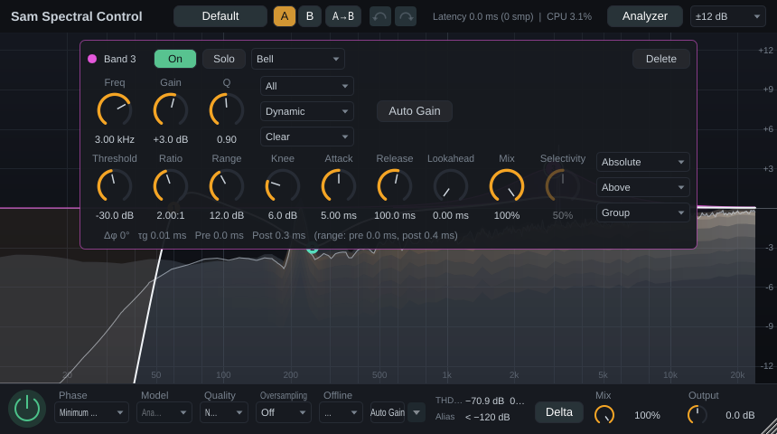

# §15 UX/UI: grupowanie, hierarchia, przyciski i animacje (propozycja po M8)

Status: **propozycja do akceptacji**. Dotyczy wyłącznie interfejsu: bez zmian w DSP, ID parametrów, stanie i presetach (więc bez migracji). Po akceptacji zostanie z niej ADR i etapy wdrożenia z §f.

Pytanie: jak ułożyć interfejs Sam Spectral Control tak, żeby był dobrze pogrupowany, żeby na pierwszym planie było to, czego używa się najczęściej, jakie subtelne animacje (np. wysuwanie panelu) pomagają, jak podzielić przyciski i sekcje — z inspiracją rozwiązaniami FabFilter.

Makiety „przed / po” (interaktywna), system przycisków, stany panelu pasma, animacje z podglądem na żywo i oba paski: canvas [Sam Spectral Control UI](https://claude.ai/artifact/WZ3NfP5hCXpi74GYGdsSvx) (strona prywatna właściciela projektu).

## a) Literatura i normy

**Grupowanie (zasady Gestalt).**
- *Bliskość* — elementy położone blisko są odbierane jako grupa; to najsilniejsza wskazówka, potrafi przeważyć podobieństwo koloru i kształtu ([NN/g, Proximity](https://www.nngroup.com/articles/gestalt-proximity/)).
- *Podobieństwo* — elementy o tych samych cechach (kolor, kształt, rozmiar) uznajemy za powiązane; spójny styl buduje oczekiwania co do działania kontrolek ([NN/g, Similarity](https://www.nngroup.com/articles/gestalt-similarity/)).
- *Wspólny obszar* — kontener grupuje zawartość, ale ramki dodawane „na wszelki wypadek” zagracają widok; najpierw odstępy, kontener dopiero gdy odstęp nie wystarcza ([NN/g, Common Region](https://www.nngroup.com/articles/common-region/), Palmer 1992).

**Hierarchia i stopniowe odsłanianie.** Złożoność opanowuje się przewidywalnym rozmieszczeniem, wyraźną hierarchią wizualną i *progressive disclosure*: najpierw to, co potrzebne zawsze, rzadkie i zaawansowane opcje za jawnie opisaną kontrolką ([NN/g, Managing Visual Complexity](https://www.nngroup.com/videos/managing-visual-complexity/)).

**Prawa Fittsa i Hicka.** Czas trafienia rośnie z odległością i maleje z rozmiarem celu, T = a + b·log₂(2D/W) ([NN/g, Fitts's Law](https://www.nngroup.com/articles/fitts-law/)) — kontrolki edytujące obiekt powinny być blisko niego. Czas decyzji rośnie z liczbą widocznych opcji (Hick) — stąd ukrywanie rzadkich opcji, ale bez wielopoziomowych menu dla rzeczy częstych.

**Dostępność (WCAG 2.1/2.2).** Tekst ≥ 4,5:1 (1.4.3); informacja wizualna potrzebna do rozpoznania kontrolki i jej stanu (łuk wartości gałki, wskaźnik, wypełnienie przełącznika, ramka fokusu) ≥ 3:1 względem otoczenia; kontrolki nieaktywne są zwolnione, efekty hover są uzupełniające ([W3C, SC 1.4.11](https://www.w3.org/WAI/WCAG21/Understanding/non-text-contrast.html)). WCAG 2.2 SC 2.5.8 — cel kliknięcia co najmniej 24 × 24 px (poziom AA).

**Ruch w interfejsie.**
- Animacja ma służyć informacji zwrotnej, zmianie stanu i ciągłości przestrzennej, a nie rozrywce: krótka, subtelna, nienachalna ([NN/g, The Role of Animation](https://www.nngroup.com/articles/animation-purpose-ux/)). Przejścia między stanami obiektu są łatwiejsze do zrozumienia animowane niż natychmiastowe; ciągły ruch utrudnia czytanie.
- Czas: większość animacji 100–500 ms; drobna informacja zwrotna ok. 100 ms; większe zmiany ekranu (np. wysunięcie okna modalnego) 200–300 ms; najkrótszy czas, który nie jest szarpany, to dobra reguła ([NN/g, Animation Duration](https://www.nngroup.com/articles/animation-duration/)).
- Material Design: elementy wchodzące — krzywa hamująca (*decelerate*, `cubic-bezier(0, 0, 0.2, 1)`), wychodzące — przyspieszająca (`cubic-bezier(0.4, 0, 1, 1)`), wejście ok. 225 ms, wyjście ok. 195 ms, przejścia powyżej 400 ms wydają się wolne; krótsze ruchy — krótsze czasy ([Material, Duration & easing](https://m1.material.io/motion/duration-easing.html)).
- Apple HIG: ruch przekazuje stan, informację zwrotną i instrukcję ([Motion](https://developer.apple.com/design/human-interface-guidelines/motion)); przy „Ogranicz ruch” animacje dekoracyjne wyłączyć, a znaczące zastąpić przenikaniem, podświetleniem lub zmianą koloru; nie usuwać wszystkich animacji ([Reduced Motion](https://developer.apple.com/help/app-store-connect/manage-app-accessibility/reduced-motion-evaluation-criteria/)). Zaczynać od tłumienia 100 % (bez „przestrzelenia”) ([WWDC18 Designing Fluid Interfaces](https://developer.apple.com/videos/play/wwdc2018/803/)).

**Ciemny motyw.** Wyższe warstwy (panel, popover) są jaśniejsze od tła — tak w ciemnym motywie widać elewację; cienie zostają ciemne; tekst w trzech poziomach ważności ([Material, Dark theme](https://m2.material.io/design/color/dark-theme)).

**JUCE 9 (w repozytorium, `external/JUCE`).** Moduł `juce_animation`: `ValueAnimatorBuilder` (domyślnie 300 ms, `withEasing`, wywołania przy starcie/zmianie/końcu), `Animator`, `Easings` (m.in. `createCubicBezier`, `createEaseOut`, `createEaseInOut`, sprężyny), `VBlankAnimatorUpdater` taktowany odświeżaniem monitora przez `VBlankAttachment` (`juce_gui_basics`). Moduł zależy od `juce_gui_basics` i zawiera kod Chromium `cubic_bezier` (BSD-3-Clause, wg `JUCE.spdx.json`).

## b) Wtyczki referencyjne — FabFilter

Źródła: oficjalna pomoc online FabFilter i ich strona „About”; zachowania niepotwierdzone w dokumentacji oznaczono `[niezweryfikowane]`.

| # | Wzorzec | Gdzie | Co z tego bierzemy |
|---|---|---|---|
| F1 | **Wyświetlacz to interfejs.** Pasma tworzy się i edytuje bezpośrednio na wykresie; panel pasma pojawia się „tuż pod zaznaczonymi pasmami, u dołu wyświetlacza” i zmienia wszystkie zaznaczone naraz | Pro-Q 4 [Band controls](https://www.fabfilter.com/help/pro-q/using/bandcontrols), [Display](https://www.fabfilter.com/help/pro-q/using/eqdisplay); Pro-MB [Display](https://www.fabfilter.com/help/pro-mb/using/display); Saturn 2: „band controls slide underneath the selected band” ([Band controls](https://www.fabfilter.com/help/saturn/using/bandcontrols)) | panel zakotwiczony w poziomie pod węzłem; wjazd panelu jako ruch związany z miejscem |
| F2 | **Bypass pasma** w lewym górnym rogu panelu; pasmo wyłączone jest przygaszone na wykresie, a w przycisku świeci czerwona lampka; Alt-klik w kropkę przełącza bypass | Pro-Q 4 Band controls | bypass jako mała ikona z lampką, nie duży przycisk „On/Off” |
| F3 | **Solo** — przycisk ze słuchawkami, działa przy przytrzymaniu; trzymając można przeciągać częstotliwość i poziom odsłuchu | Pro-Q 4 [Solo](https://www.fabfilter.com/help/pro-q/using/solo) | ikona słuchawek; przytrzymanie = chwilowo |
| F4 | **Dynamika odsłaniana na żądanie**: pierścień zakresu wokół gałki Gain — ustawienie ≠ 0 czyni pasmo dynamicznym i *odsłania* dodatkowe kontrolki; przycisk „Expand >>” przełącza tryb automatyczny i własny (próg, attack, release); w suwaku progu widać poziom sygnału wyzwalającego; przycisk Spectral u góry pierścienia | Pro-Q 4 [Dynamic EQ](https://www.fabfilter.com/help/pro-q/using/dynamic-eq), [Spectral Dynamics](https://www.fabfilter.com/help/pro-q/using/spectral-dynamics) | tryb pasma widoczny od razu; sekcja dynamiki rozwijana; poziom detekcji przy progu |
| F5 | **Zaawansowane za przyciskiem, z sygnalizacją niedomyślnych ustawień**: przycisk Side Chain otwiera panel zaawansowany i świeci na żółto z opisem, gdy coś w nim odbiega od domyślnych | Pro-C 3 [Side chain section](https://www.fabfilter.com/help/pro-c/using/sidechainsection) | kropka „zmienione” na przycisku Advanced |
| F6 | **Panel wysuwany**: przycisk „Advanced” pod suwakiem Gain wysuwa panel z Style, Lookahead, Attack, Release, Channel Link; ponowne kliknięcie chowa | Pro-L 2 [Advanced settings](https://www.fabfilter.com/help/pro-l/using/advancedsettings) | sekcja Advanced w panelu pasma |
| F7 | **Ukryte, aż potrzebne**: źródła modulacji ukryte na starcie, „>>” pokazuje, „<<” chowa; panel slotu modulacji wyskakuje przy kontrolce docelowej | Saturn 2 [Modulation](https://www.fabfilter.com/help/saturn/using/modulation), [Slots](https://www.fabfilter.com/help/saturn/using/modulationslots) | popover przy elemencie, którego dotyczy |
| F8 | **Górny pasek**: przycisk presetu z nazwą (przygasa po zmianie parametru), strzałki poprzedni/następny, przeglądarka; Undo/Redo wyszarzone, gdy nic do cofnięcia; A/B zapamiętuje stan przed przełączeniem; Copy wyłącza się, gdy oba stany są równe | Pro-Q 4 [Loading presets](https://www.fabfilter.com/help/pro-q/presets/loadingpresets), [Undo/A-B](https://www.fabfilter.com/help/pro-q/using/undoredo) | strzałki presetów, znacznik „zmieniony”, nieaktywne Copy |
| F9 | **Dolny pasek**: tryb przetwarzania, lista instancji (środek), analizator, Character, wyjście (Auto Gain, Gain Scale, Output), zmiana rozmiaru (Mini…Extra Large, skalowanie) | Pro-Q 4 [Overview](https://www.fabfilter.com/help/pro-q/using/overview), [Output](https://www.fabfilter.com/help/pro-q/using/output), [Resize](https://www.fabfilter.com/help/pro-q/using/fullscreenandresize) | globalne ustawienia na dole, wyjście po prawej |
| F10 | **Zakres wykresu** (±3/6/12/30 dB) w prawym górnym rogu wyświetlacza | Pro-MB Display | zakres skali przy skali, nie w nagłówku |
| F11 | **Gałki**: Shift = precyzyjnie, kółko myszy, Ctrl/Cmd-klik = reset, dwuklik = wpisanie wartości („1k”, „2x”, „50%”) | Pro-Q 4 [Knobs](https://www.fabfilter.com/help/pro-q/using/knobs) | wspólne zachowanie wszystkich gałek |
| F12 | **Filozofia**: „expose the features you need, when you need them”; odejście od kopiowania sprzętu; jakość zamiast liczby funkcji | [About FabFilter](https://www.fabfilter.com/about); F. Slijkerman w [MusicRadar](https://musicradar.com/news/tech/meet-the-programmers-fabfilter-574996) | zasada nadrzędna tej propozycji |

Animacje FabFilter (płynne pojawianie się panelu pasma, przenikania) nie są opisane w dokumentacji `[niezweryfikowane]` — parametry ruchu w §d9 wynikają z wytycznych z §a, nie z pomiaru ich wtyczek.

## c) Audyt obecnego interfejsu (wersja 1.0)




| # | Problem | Fakty | Zasada |
|---|---|---|---|
| A1 | Nagłówek miesza cztery role o tej samej wadze: tożsamość, zarządzanie stanem (preset, A/B, kopiowanie, Undo/Redo), status (latencja, CPU), ustawienia widoku (Analyzer, zakres EQ) | brak przerw i separatorów między rolami | bliskość, hierarchia |
| A2 | Dolny pasek: 11 kontrolek w jednym rzędzie bez grup; Offline (rzadkie) i Model (aktywny tylko w Analog Feel) zajmują miejsce na równi z Phase i Quality | przy 860 px etykiety się ucinają: „Minimum …”, „Ana…”, „N…”, „…”, „THD…” | Hick, bliskość |
| A3 | Mix i Output to gałki ok. 20 px, a wartość jest 40 px dalej | mały cel, rozdzielona etykieta | Fitts |
| A4 | Panel pasma jest zawsze wyśrodkowany na wykresie, niezależnie od położenia węzła; gdy zasłania węzeł, przeskakuje do góry bez animacji | panel Dynamic ma 684 × 232 px — ok. 25 % pola wykresu przy 1100 × 660; w oknie 860 × 480 zasłania większość krzywej | Fitts, ciągłość |
| A5 | Pierwszy rząd panelu łączy tożsamość pasma, przełączniki stanu, kształt i destrukcyjne „Delete” — wszystkie jako przyciski tej samej wagi | Delete obok Shape, bez potwierdzenia (na szczęście z Undo) | hierarchia, ochrona przed błędem |
| A6 | Tryb pasma (Static / Dynamic / Spectral) — kluczowa decyzja — jest w trzeciej, niepodpisanej liście rozwijanej; listy Target, Mode, Character nie mają etykiet | „All”, „Static”, „Clear” bez podpisu | widoczność stanu |
| A7 | Rząd dynamiki: 9 gałek o identycznym rozmiarze i kolorze + 3 niepodpisane listy (Absolute / Above / Group) | Knee, Lookahead, Mix, Link, Selectivity zawsze widoczne | progressive disclosure |
| A8 | Wszystkie gałki są pomarańczowe (akcent), a kolor pasma występuje tylko w kropce i ramce | słabe powiązanie panel ↔ węzeł | podobieństwo |
| A9 | Tor gałki i obramowania list mają kontrast 1,24:1 do panelu; gałka na 0 (np. Lookahead 0 ms) wygląda jak sama kreska | `panelEdge #272c35` na `panel #171a20` | WCAG 1.4.11 (wskaźnik stanu ma 3:1, zakres gałki ginie) |
| A10 | Tekst pomocniczy (`textDim #79838f`) ma 4,53:1 do panelu — na granicy AA | — | WCAG 1.4.3 |
| A11 | Max Lookahead nie ma kontrolki w interfejsie (tylko parametr hosta i automatyczne podnoszenie) | — | wykrywalność |
| A12 | Brak animacji: panel pojawia się i znika skokowo, zmiana trybu zmienia jego wysokość skokowo, przeskok góra/dół | — | ciągłość zmian stanu (NN/g) |
| A13 | Brak wskaźnika zmienionego presetu, strzałek poprzedni/następny, nieaktywnego „A→B” przy równych stanach | — | F8 |
| A14 | Brak przycisku pomocy i ustawień interfejsu (rozmiar, animacje) | — | F8, F9 |

## d) Propozycja

### d1. Zasady

1. **Wykres jest interfejsem.** Największa powierzchnia i najwyższy kontrast należą do krzywej i węzłów; wszystko inne jej służy i zasłania ją jak najmniej.
2. **Trzy poziomy ważności.** *Pierwszy plan* (zawsze widoczny, najsilniejszy kontrast): krzywa, węzły, Freq/Gain/Q zaznaczonego pasma, tryb pasma, bypass globalny, Output. *Drugi plan* (widoczny, spokojniejszy): kształt, nachylenie, cel, Character, tryb fazy, Quality, oversampling, Auto Gain, Mix, presety, A/B. *Trzeci plan* (odsłaniany): Knee, Lookahead, Mix pasma, Link, oversampling offline, Max Lookahead, progi mierników, szczegóły analizatora.
3. **Grupy przez odstęp, kontener tylko dla warstwy.** Grupy w paskach oddziela odstęp 16–24 px i cienka linia; ramkę ma tylko to, co leży nad wykresem (panel, popover, szuflada).
4. **Edycja przy obiekcie.** Kontrolki pasma pojawiają się pod jego węzłem; popover wyrasta z przycisku, który go otworzył.
5. **Jeden przycisk = jeden typ.** Sześć typów przycisków (§d7) o stałym wyglądzie; ten sam stan wygląda wszędzie tak samo.
6. **Ruch tylko dla ciągłości i informacji zwrotnej.** 80–250 ms, bez odbić, zawsze przerywalny; nic nie czeka na animację; krzywa nigdy nie „goni” dźwięku.
7. **Widać, że coś odbiega od domyślnego.** Ukryte ustawienie różne od domyślnego zostawia kropkę na przycisku, który je odsłania (F5).

### d2. Strefy okna

```
┌───────────────────────────────────────────────────────────────────────────────────────────┐
│ Sam Spectral Control 1.0 │ ‹ Default • › │ A|B ⧉ │ ↶ ↷ │      85,3 ms · CPU 3 % │ Analyzer▾ ⚙ ? │  nagłówek 40 px
├───────────────────────────────────────────────────────────────────────────────────────────┤
│                                                                              ±12 dB ▾     │  zakres przy skali (F10)
│                                     ●3                                                    │
│                          ●2        /  \                                           ●4     │  wykres: krzywa, węzły,
│ ●1 ───────────\________/          \________________________________/                   │  analizator, poświata
│                                  ╭────────────────────────────╮                          │
│                                  │ panel pasma pod węzłem 3   │                          │  panel zakotwiczony w
│                                  ╰────────────────────────────╯                          │  poziomie przy węźle
│ 20     50    100    200     500    1k     2k      5k     10k    20k                       │
├───────────────────────────────────────────────────────────────────────────────────────────┤
│ ⏻ │ Phase       Quality   Oversampling │          THD+N −71 dB │ Delta  Auto Gain▾  Mix  Output │  dolny pasek 56 px
│   │ Minimum ▾   Normal ▾  Off ▾        │          Alias <−120  │                 ◯100%  ◯0,0 dB │
└───────────────────────────────────────────────────────────────────────────────────────────┘
   przetwarzanie                           pomiary                  odsłuch i wyjście
```

### d3. Nagłówek (40 px)

Od lewej, cztery grupy oddzielone odstępem 16 px i linią 1 px:

1. **Tożsamość**: nazwa (15 px, półgruba) i wersja (11 px, trzeci plan). Przy oknie < 1000 px — sama nazwa.
2. **Presety**: `‹` *Nazwa presetu* `›`. Kropka po nazwie i przygaszenie, gdy ustawienia różnią się od wczytanego presetu (F8). Kliknięcie nazwy — dotychczasowe menu (Factory / User / Save As… / Delete / Show Preset Folder).
3. **Porównanie i historia**: segmented `A | B`, ikona kopiowania `⧉` (podpowiedź „Copy A to B”, nieaktywna, gdy stany są równe), `↶ ↷` (nieaktywne, gdy nie ma czego cofnąć — jak teraz).
4. **Status i widok** (do prawej): *chip statusu* „85,3 ms · CPU 3 %” (drugi plan; krótki puls koloru przy zmianie latencji, jak teraz), split button **Analyzer ▾**, ikona **⚙** (szuflada ustawień), ikona **?** (instrukcja i „podpowiedzi”).

Zakres skali EQ przenosimy z nagłówka do prawego górnego rogu wykresu, nad skalę dB (F10): to ustawienie widoku wykresu, więc powinno być przy nim.

### d4. Panel pasma

**Położenie (F1).** Panel ma stałą wysokość dokowania: u dołu wykresu, 12 px nad skalą częstotliwości; w poziomie środek panelu = x węzła (dla zaznaczenia wielu pasm — środek zaznaczenia), przycięty do 8 px od krawędzi. Gdy węzeł leży w pasie zasłanianym przez panel, panel dokuje u góry wykresu. Podczas przeciągania węzła panel stoi; po puszczeniu przesuwa się do nowej pozycji (§d9, poz. 5–6), więc cel nie ucieka spod kursora. Mały trójkątny „ogonek” (8 px) na krawędzi panelu wskazuje węzeł.

**Wymiary.** Stała szerokość 560 px — dziś panel ma 482 px w trybie Static i 684 px w Dynamic, więc przy zmianie trybu skacze też w poziomie. Wysokość: Static ok. 140 px, Dynamic ok. 230 px, z Advanced ok. 290 px. Panel Static zajmuje ok. 12 % pola wykresu (dziś ok. 11 %, ale tryb jest w nim widoczny na stałe), Dynamic ok. 21 % (dziś ok. 25 %).

**Układ (od góry):**

```
╭───────────────────────────────────────────────────────────────────────╮
│ ● Band 3    [◠ Bell ▾]      [ Static | Dynamic | Spectral ]   ⏻  🎧  ⋯ │  nagłówek: tożsamość · kształt · TRYB · stan
│                                                                       │
│   ◯ Freq      ◯ Gain      ◯ Q            Target  Stereo ▾             │  EQ: trzy duże gałki w kolorze pasma
│   3,00 kHz    +3,0 dB     0,90           Character  Clear ▾          │  + wartości drugiego planu
│ ── Dynamics ─────────────────────────────────────── [Auto Gain] ───── │  sekcja tylko w Dynamic / Spectral
│   ◯ Threshold   ◯ Ratio     ◯ Range   ◯ Attack   ◯ Release   Advanced ▸• │
│   −30 dB        2,0:1       12 dB     5 ms       100 ms              │
│   [Abs|Rel]     [Above|Below]                                         │  mini segmented pod gałkami
│ ── Advanced (rozwijane) ─────────────────────────────────────────── │
│   ◦ Knee 6 dB   ◦ Lookahead 0 ms   ◦ Mix 100 %   Link  Group ▾        │  trzeci plan: małe gałki
│ ⓘ Δφ 2° · τg 0,01 ms · pre 0,0 ms · post 0,4 ms                       │  odczyty — stopka, trzeci plan
╰───────────────────────────────────────────────────────────────────────╯
```

- **Nagłówek panelu**: kropka i „Band 3” w kolorze pasma; przycisk kształtu z miniaturą krzywej (popover z siatką kształtów z ikonami zamiast listy tekstowej); **segmented Static | Dynamic | Spectral** — tryb widoczny zawsze, jedno kliknięcie zamiast otwierania listy (segmenty Dynamic i Spectral nieaktywne dla kształtów bez wzmocnienia, z podpowiedzią dlaczego); po prawej ikony: **bypass** z lampką (F2), **solo** ze słuchawkami — przytrzymanie = chwilowo, kliknięcie = zatrzaśnięte (F3) — i **⋯** (Copy, Paste, Reset, Delete; Delete czerwonym tekstem, nadal z klawiszem Delete). Znika duży przycisk „Delete” i „On/Off” z napisem.
- **EQ**: Freq, Gain, Q jako gałki 48 px z łukiem w kolorze pasma (podobieństwo z węzłem, A8). Slope pojawia się obok kształtu dla cięć i półek; dla kształtów bez Q gałka Q jest przygaszona (jak teraz). Target i Character jako *value buttons* z podpisem (A6); w surround obok Target — „Speakers: All ▾”.
- **Dynamics** (rozwija się przy przełączeniu trybu, §d9 poz. 7): nagłówek sekcji z cienką linią i przełącznikiem **Auto Gain** (dla pasm Dynamic/Spectral). Pięć gałek 40 px: Threshold (z mini-segmented Abs | Rel pod spodem; docelowo z łukiem poziomu detekcji wewnątrz, jak próg w Pro-C 3 i Pro-Q 4 — wymaga telemetrii poziomu z silnika), Ratio (z Above | Below), Range, Attack, Release. W trybie Spectral zamiast Lookahead (nieużywany) w pierwszym rzędzie pojawia się **Selectivity**.
- **Advanced ▸** (F6): Knee, Lookahead (tylko Dynamic), Mix pasma, Link — gałki 32 px i value button. Kropka na „Advanced”, gdy któreś ma wartość niedomyślną (F5). Stan rozwinięcia zapamiętany w ustawieniach interfejsu.
- **Gałka Gain pasma dynamicznego** pokazuje cienkim wewnętrznym łukiem bieżącą zmianę wzmocnienia (dziś widać ją tylko na krzywej) — informacja zwrotna tam, gdzie patrzy użytkownik (jak żółty pasek w pierścieniu Pro-Q 4).
- **Odczyty** (Δφ, τg, pre/post ring) — stopka 11 px z ikoną ⓘ; kolor ostrzegawczy jak teraz. Opcja w ustawieniach: ukryj odczyty.

### d5. Dolny pasek (56 px)

Grupy od lewej: **⏻** | **Przetwarzanie**: Phase, Model (tylko w Analog Feel — pojawia się animowany, §d9 poz. 15), Quality, Oversampling | odstęp | **Pomiary**: THD+N, Alias | **Odsłuch i wyjście**: Delta, Auto Gain ▾, Mix, Output.

- Phase, Model, Quality, Oversampling jako *value buttons*: podpis 11 px nad wartością, ▾ widoczne po najechaniu, bez ramki (mniej szumu niż dziś przy pięciu obramowanych listach). Kolejność od najważniejszego.
- **Offline** przechodzi do szuflady ustawień; gdy różny od „Same”, przycisk Oversampling pokazuje to w wartości: „Off · 8x offline”.
- **Mix** i **Output**: gałki 32 px z wartością bezpośrednio pod (Fitts, A3); Output z małym wskaźnikiem poziomu wyjścia (P2).
- **Delta** obok Mix — oba dotyczą tego, co słychać; Delta włączona: wypełnienie akcentem (bursztyn) i obwódka, bez migania.
- **Responsywność** (A2): przy szerokości < 1000 px podpisy znikają (zostają w podpowiedziach), Phase pokazuje krótkie nazwy (Min / Natural / Analog), mierniki zwijają się do jednego wskaźnika „THD” z kolorem stanu i szczegółami w podpowiedzi; przy 860 px żadna etykieta nie jest ucięta.

### d6. Szuflada ustawień, pomoc, popover analizatora

- **⚙ Szuflada** (wysuwana z prawej, 300 px, nad wykresem z przyciemnieniem 40 %): *Processing* — Offline oversampling, Max Lookahead (dziś niedostępny w interfejsie, A11); *Auto Gain* — Weighting, Speed (zostają też w menu ▾ przy przycisku); *Meters* — progi ostrzeżeń THD+N i aliasingu; *Interface* — rozmiar (S / M / L / XL, jak w F9, obok swobodnego skalowania), animacje (Full / Reduced / Off), odczyty w panelu (wł./wył.), podpowiedzi rozszerzone (wł./wył.). Każde ustawienie ma jednozdaniowy opis. Kropka na ⚙, gdy Offline ≠ Same albo Max Lookahead > 0.
- **? Pomoc**: otwiera instrukcję (zainstalowany `Manual.md` lub wersję online) i przełącza *podpowiedzi rozszerzone* — dłuższe opisy w tooltipach (odpowiednik „interactive help hints” FabFilter).
- **Analyzer ▾** jako split button: lewa część włącza/wyłącza widmo, prawa otwiera *popover* zamiast menu z podmenu. Sekcje: *Spectrum* (Pre / Post jako przełączniki, Freeze), *Display* (Resolution, Speed, Tilt, Range jako segmented), *Overlays* (Activity glow, Resonance hints + czułość, EQ phase overlay). Wszystkie opcje widać naraz — mniej kliknięć niż w podmenu (Hick, Fitts).

### d7. System przycisków

| Typ | Kiedy | Wygląd | Przykłady |
|---|---|---|---|
| **Toggle** (przełącznik funkcji) | włącza/wyłącza funkcję | etykieta na neutralnym tle; *on*: wypełnienie kolorem semantycznym | Auto Gain, Delta, podpowiedzi |
| **Ikona stanu** | stan elementu, często przełączany | 28 × 28 px, ikona 16 px, lampka/kolor w stanie aktywnym | bypass pasma (czerwona lampka), solo (bursztyn), ⏻ globalny (zielony) |
| **Segmented** | 2–4 wykluczające się opcje zmieniane często | wspólny kontener, przesuwany wskaźnik | A/B, Static/Dynamic/Spectral, Abs/Rel, Above/Below, sekcje popovera |
| **Value button** | wybór z listy, zmieniany rzadziej | wartość + ▾ (▾ widoczny na hover), podpis nad, bez ramki | Phase, Quality, Oversampling, Model, Shape, Slope, Target, Character, Link |
| **Ikona akcji** (ghost) | akcje pomocnicze | 28 × 28 px, tło tylko na hover | ↶ ↷, ‹ ›, ⧉, ⚙, ?, ⋯ |
| **Split button** | funkcja + jej ustawienia | toggle po lewej, ▾ po prawej, wspólny obrys | Analyzer, Auto Gain |
| **Destrukcyjny** | usuwanie | tylko w menu ⋯ (czerwony tekst) i klawiszem Delete | Delete band, Delete preset |
| **Główna akcja** | jedna w oknie dialogowym | wypełniony akcentem | Save w oknie zapisu presetu |

**Stany** (wszystkie typy): domyślny; hover (+6 % jasności tła, 90 ms); wciśnięty (−4 %); fokus klawiatury (pierścień 2 px, ≥ 3:1); nieaktywny (krycie 38 %, bez hover, podpowiedź wyjaśnia dlaczego); aktywny/on (wypełnienie); *niedomyślny* (kropka 6 px w prawym górnym rogu).

**Rozmiary**: cel kliknięcia ≥ 24 × 24 px (WCAG 2.2 2.5.8), w paskach wysokość 28 px; gałki 48 px (pierwszy plan), 40 px (drugi), 32 px (trzeci); wszystkie gałki mają to samo zachowanie (F11: Shift, kółko, Ctrl/Cmd-klik = reset, dwuklik = wpisanie).

**Kolory semantyczne**: *kolor pasma* = tożsamość pasma (węzeł, ramka panelu, łuki gałek w panelu); *bursztyn* `#f5a524` = „słyszysz coś innego niż normalny tor” i uwaga (Solo, Delta, podpowiedź oversamplingu, zmiana latencji) — przestaje być kolorem każdej gałki; *zielony* = przetwarzanie włączone; *czerwony* = pasmo wyłączone (lampka), ostrzeżenia mierników; *cyjan* = nakładki informacyjne (faza). Kolor zawsze idzie w parze z kształtem lub tekstem (nie tylko barwa).

### d8. Tokeny wizualne

| Token | Wartość | Kontrast (do panelu `#1b1f26`) |
|---|---|---|
| tło okna | `#0f1115` | — |
| wykres | `#13161c` → `#0c0e12` | — |
| panel (warstwa 1) | `#1b1f26` + cień `0 8 24 rgba(0,0,0,.45)` | — |
| popover, szuflada (warstwa 2) | `#232831` | — |
| tekst główny | `#e6ebf0` | 13,8:1 |
| tekst drugiego planu, wartości | `#a3adb8` | 7,3:1 |
| podpisy (tylko na tle i panelu) | `#7f8995` | 4,7:1 |
| tor gałki | `#3b424d` → docelowo ≥ 2:1 | 1,6:1 (dziś 1,24:1) |
| linie podziału | `#2b313b` | dekoracyjne |
| akcent | `#f5a524` | 8,1:1 |

- **Typografia**: jedna rodzina w trzech rozmiarach (11 / 12,5 / 15 px) i cyfry o stałej szerokości dla wartości (wartości nie „skaczą” przy zmianie). Propozycja: IBM Plex Sans i IBM Plex Mono (licencja SIL OFL 1.1), osadzone w binarce — ten sam wygląd na macOS, Windows i Linuksie (dziś czcionka systemowa); wymaga dopisania do `THIRD-PARTY-NOTICES.txt`.
- **Siatka**: 4 px; odstępy 8 / 12 / 16 / 24; promienie 6 px (kontrolki), 10 px (panel, popover).

### d9. Animacje

Krzywe: *wejście* `cubic-bezier(0, 0, 0.2, 1)`, *wyjście* `cubic-bezier(0.4, 0, 1, 1)`, *standard* (przesunięcie w obrębie ekranu) `cubic-bezier(0.2, 0, 0, 1)`.

| # | Zdarzenie | Animacja | Czas | Krzywa | „Ogranicz ruch” |
|---|---|---|---|---|---|
| 1 | najechanie na przycisk, węzeł, gałkę | kolor tła / obrysu; węzeł: promień ×1,15 i poświata | 90 ms (powrót 140 ms) | wejście | tylko kolor |
| 2 | wciśnięcie | przyciemnienie, bez skalowania | natychmiast | — | bez zmian |
| 3 | pojawienie się panelu pasma | przenikanie + przesunięcie 8 px od strony węzła | 160 ms | wejście | przenikanie 100 ms |
| 4 | zniknięcie panelu | przenikanie + 4 px | 110 ms | wyjście | przenikanie 80 ms |
| 5 | przejście panelu do innego pasma | przesunięcie w poziomie + przenikanie treści | 160 ms (treść 90 ms) | standard | skok + przenikanie treści |
| 6 | przeniesienie panelu dół ↔ góra | przesunięcie | 180 ms | standard | przenikanie 120 ms |
| 7 | rozwinięcie Dynamics / Advanced | wysokość panelu + przenikanie treści (opóźnione o 40 ms) | 180 ms (zwinięcie 140 ms) | standard | natychmiast |
| 8 | segmented (A/B, tryb pasma) | przesunięcie wskaźnika | 140 ms | standard | natychmiast |
| 9 | szuflada ustawień | wjazd 24 px z prawej + przenikanie; przyciemnienie tła do 40 % | 200 ms / zamknięcie 150 ms | wejście / wyjście | przenikanie |
| 10 | popover (analizator, kształt, głośniki) | skala 0,97 → 1 + przenikanie, z punktu przycisku | 130 ms / 90 ms | wejście / wyjście | przenikanie |
| 11 | podpowiedź | przenikanie po 600 ms zwłoki (bez zwłoki, gdy inna jest już widoczna) | 100 ms | liniowa | bez zmian |
| 12 | wartość przy przeciąganiu węzła | przenikanie; znika 400 ms po puszczeniu | 80 ms | — | bez zmian |
| 13 | zmiana latencji | jeden puls koloru chipu statusu | 600 ms | wyjście | zmiana koloru bez pulsu |
| 14 | podpowiedź oversamplingu ▴ | jeden puls przy pojawieniu się | 600 ms | wyjście | bez pulsu |
| 15 | kontrolka Model (Analog Feel) | szerokość + przenikanie | 160 ms | standard | natychmiast |
| 16 | Solo / Delta włączone | kolor i obwódka (bez migania) | 120 ms | wejście | bez zmian |
| 17 | (opcjonalnie) wczytanie presetu, A/B, Undo | krzywa i węzły przechodzą do nowego stanu | 120 ms | standard | natychmiast |

Reguły:
- **Krzywa nie goni dźwięku.** Zmiany parametrów (przeciąganie, automatyzacja) rysujemy natychmiast; animowana jest tylko „rama” interfejsu. Wyjątek nr 17 jest krótszy od wygładzania zmian w silniku i można go wyłączyć.
- **Przerywalność.** Każda animacja startuje od bieżącej wartości (nie od początku); kliknięcie w trakcie trafia w docelowy układ — nic nie blokuje wejścia.
- **Bez pętli i odbić.** Żadnej animacji w kółko poza danymi (analizator, mierniki, poświata), żadnego „przestrzelenia” (tłumienie 100 %, §a).
- **Ogranicz ruch.** Ustawienie *Animations: Full / Reduced / Off*; domyślnie z systemu, tam gdzie da się to odczytać (macOS: `NSWorkspace.accessibilityDisplayShouldReduceMotion`; Windows: `SystemParametersInfo(SPI_GETCLIENTAREAANIMATION)`; Linux: brak standardu — Full). *Reduced* = tylko przenikania ≤ 100 ms; *Off* = natychmiast.
- **Koszt.** Animacje taktowane odświeżaniem monitora (`VBlankAttachment`), odrysowywany tylko animowany obszar; przesunięcia przez `Component::setTransform`, przenikanie krótko (≤ 160 ms), bo `setAlpha` rysuje przez warstwę pośrednią; bez animacji — zero wywołań na klatkę.

### d10. Gdzie trafia każdy obecny element

| Obecnie | Proponowane miejsce |
|---|---|
| Preset (nagłówek) | nagłówek: `‹` nazwa `›` + kropka „zmieniony” |
| A, B, A→B | segmented `A \| B` + ikona `⧉` (nieaktywna przy równych stanach) |
| Undo, Redo | bez zmian (ikony), grupa „historia” |
| Linia statusu (latencja, CPU) | chip statusu po prawej stronie nagłówka |
| Analyzer (menu z podmenu) | split button + popover z sekcjami |
| Zakres EQ (nagłówek) | prawy górny róg wykresu, przy skali dB |
| On / Off pasma | ikona bypass z lampką w nagłówku panelu |
| Solo pasma | ikona słuchawek (przytrzymanie / zatrzaśnięcie) |
| Delete pasma | menu ⋯ i klawisz Delete |
| Shape (lista) | przycisk z miniaturą kształtu + popover z ikonami |
| Mode (lista) | segmented Static / Dynamic / Spectral w nagłówku panelu |
| Target, Character (listy bez podpisu) | value buttons z podpisem obok gałek EQ |
| Auto Gain pasma | przełącznik w nagłówku sekcji Dynamics |
| Threshold Mode, Direction (listy) | mini segmented pod Threshold i Ratio |
| Knee, Lookahead, Mix, Link | sekcja Advanced (rozwijana, z kropką „zmienione”) |
| Selectivity | pierwszy rząd dynamiki tylko w trybie Spectral |
| Odczyty pasma | stopka panelu z ⓘ |
| Phase, Model, Quality, Oversampling | grupa „Przetwarzanie” w dolnym pasku, value buttons; Model tylko w Analog Feel |
| Offline | szuflada ⚙ + wskaźnik w wartości Oversampling |
| Auto Gain ▾ | split button w grupie „Odsłuch i wyjście” |
| Mierniki | grupa „Pomiary” (bez zmian w treści) |
| Delta | obok Mix |
| Mix, Output | większe gałki z wartością pod spodem |
| Max Lookahead (tylko w hoście) | szuflada ⚙ |
| Progi mierników (menu Analyzer) | szuflada ⚙ |

## e) Kryteria akceptacji

| # | Kryterium | Sprawdzenie |
|---|---|---|
| E1 | Grupy w paskach oddzielone ≥ 16 px albo linią; każda sekcja panelu ma podpis | przegląd zrzutów `ssc_screenshot` |
| E2 | Panel Static: ≤ 11 widocznych kontrolek; Dynamic (Advanced zwinięte): ≤ 19, w tym 5 gałek dynamiki zamiast 9 i żadnej listy bez podpisu (dziś 11–12 i 23–24) | liczenie na zrzutach |
| E3 | Tekst ≥ 4,5:1 do swojej warstwy; wskaźniki stanu kontrolek ≥ 3:1 (WCAG 1.4.11); tor gałki ≥ 2:1 | test jednostkowy tokenów kolorów (kontrast liczony jak w WCAG) |
| E4 | Cele kliknięcia ≥ 24 × 24 px przy skali 100 %; gałki ≥ 32 px | test układu (rozmiary komponentów) |
| E5 | Przy 860 × 480 żadna etykieta nie jest ucięta | zrzut + test układu |
| E6 | Panel nigdy nie zasłania zaznaczonego węzła; środek panelu w poziomie = x węzła (± przycięcie do krawędzi) | test czystej funkcji położenia panelu (jak `BandLogic`) |
| E7 | Animacje „ramy” 80–250 ms, przerywalne, bez blokowania wejścia; *Reduced* i *Off* działają; ustawienie systemowe odczytane na macOS i Windows | testy zegara animacji (wstrzykiwany czas), zrzuty w t = 0 / 50 % / 100 % |
| E8 | CPU interfejsu (`ssc_screenshot profile=`) nie wyższe niż dziś o > 10 %; bez animacji brak wywołań na klatkę | pomiar przed/po |
| E9 | Max Lookahead i Offline oversampling osiągalne w ≤ 2 kliknięciach | przegląd |
| E10 | Kolejność Tab zgodna z grupami (nagłówek → wykres → panel → dolny pasek), widoczny pierścień fokusu | test ręczny |

## f) Plan wdrożenia

Bez zmian w parametrach, ID i stanie (ustawienia interfejsu w dziecku stanu jak ustawienia analizatora) — presety i sesje bez migracji.

| Etap | Zakres | Ryzyko |
|---|---|---|
| U1 Tokeny i przyciski | tokeny kolorów i typografii (§d8), komponenty: segmented, value button, ikona stanu, split button, kropka „zmienione”; pierścień fokusu; test kontrastu tokenów | niskie |
| U2 Paski i szuflada | regrupowanie nagłówka i dolnego paska, zakres EQ przy wykresie, strzałki i znacznik presetu, nieaktywne Copy, szuflada ⚙ (Offline, Max Lookahead, progi, interfejs), przycisk ?, reguły responsywne | niskie |
| U3 Panel pasma | zakotwiczenie przy węźle (czysta funkcja + test), nowy nagłówek z trybem, ⋯, sekcje Dynamics/Advanced, value buttons, łuk dynamicznej zmiany na Gain, popover kształtów | średnie (najwięcej zmian w `BandPanel`) |
| U4 Ruch | pomocnik `ui/Motion` na `VBlankAttachment` z własną krzywą Béziera (ok. 60 linii, bez kodu zewnętrznego) zamiast `juce_animation` — ten wniósłby kod Chromium `cubic_bezier` (BSD-3) do `THIRD-PARTY-NOTICES.txt`; animacje z §d9, *Reduced/Off*, odczyt ustawienia systemowego (`.mm` na macOS); `ssc_screenshot motion=<ms>` do zrzutów w trakcie animacji | średnie (koszt rysowania programowego — pomiar E8) |
| U5 Popovery | popover analizatora, popover kształtów, animowany panel głośników; łuk poziomu detekcji przy Threshold (nowa telemetria z silnika, atomics jak dla wzmocnienia dynamicznego) | średnie |

Po każdym etapie: zrzuty do `docs/images`, aktualizacja instrukcji (rozdz. 3, 4, 11, 12), `tools/ci/local-check.sh`.

## g) Pytania do decyzji

1. **Skróty jak w FabFilter?** Dziś Alt + przytrzymanie węzła = Solo. FabFilter: Alt-klik = bypass pasma, solo przyciskiem ze słuchawkami. Zgodność ułatwi życie użytkownikom Pro-Q; zmiana wymaga nowej wersji instrukcji. Rekomendacja: przejść na konwencję FabFilter.
2. **Rozmiar okna**: zostawić swobodne skalowanie i dodać rozmiary S/M/L/XL (rekomendacja), czy tylko rozmiary stałe jak w FabFilter.
3. **Czcionka**: osadzić IBM Plex (OFL, spójny wygląd na wszystkich systemach) czy zostać przy systemowej.
4. **Odczyty w panelu**: widoczne domyślnie (jak teraz — wyróżnik wtyczki) czy dopiero po kliknięciu ⓘ.
5. **Pierścień zakresu wokół Gain** (dosłownie jak Pro-Q 4) zamiast osobnej gałki Range: zwarte, ale inny model (u nas Range jest wielkością, kierunek wynika z Ratio i Direction). Rekomendacja: zostać przy gałce Range, dodać łuk bieżącej zmiany na Gain.

## Źródła

- FabFilter Pro-Q 4 Help: [Overview](https://www.fabfilter.com/help/pro-q/using/overview), [Band controls](https://www.fabfilter.com/help/pro-q/using/bandcontrols), [Display and workflow](https://www.fabfilter.com/help/pro-q/using/eqdisplay), [Dynamic EQ](https://www.fabfilter.com/help/pro-q/using/dynamic-eq), [Spectral Dynamics](https://www.fabfilter.com/help/pro-q/using/spectral-dynamics), [Solo](https://www.fabfilter.com/help/pro-q/using/solo), [Knobs](https://www.fabfilter.com/help/pro-q/using/knobs), [Output options](https://www.fabfilter.com/help/pro-q/using/output), [Full Screen, resizing and scaling](https://www.fabfilter.com/help/pro-q/using/fullscreenandresize), [Undo, redo, A/B](https://www.fabfilter.com/help/pro-q/using/undoredo), [Loading presets](https://www.fabfilter.com/help/pro-q/presets/loadingpresets)
- FabFilter Pro-C 3 Help: [Side chain section](https://www.fabfilter.com/help/pro-c/using/sidechainsection), [Dynamics controls](https://www.fabfilter.com/help/pro-c/using/dynamicscontrols); Pro-L 2 Help: [Advanced settings](https://www.fabfilter.com/help/pro-l/using/advancedsettings); Pro-MB Help: [Display](https://www.fabfilter.com/help/pro-mb/using/display); Saturn 2 Help: [Band controls](https://www.fabfilter.com/help/saturn/using/bandcontrols), [Modulation](https://www.fabfilter.com/help/saturn/using/modulation), [Modulation slots](https://www.fabfilter.com/help/saturn/using/modulationslots)
- [About FabFilter](https://www.fabfilter.com/about); [MusicRadar: Meet the programmers — FabFilter](https://musicradar.com/news/tech/meet-the-programmers-fabfilter-574996)
- NN/g: [Proximity](https://www.nngroup.com/articles/gestalt-proximity/), [Similarity](https://www.nngroup.com/articles/gestalt-similarity/), [Common Region](https://www.nngroup.com/articles/common-region/), [Managing Visual Complexity](https://www.nngroup.com/videos/managing-visual-complexity/), [Fitts's Law](https://www.nngroup.com/articles/fitts-law/), [The Role of Animation and Motion in UX](https://www.nngroup.com/articles/animation-purpose-ux/), [Animation Duration](https://www.nngroup.com/articles/animation-duration/)
- W3C: [Understanding SC 1.4.11 Non-text Contrast](https://www.w3.org/WAI/WCAG21/Understanding/non-text-contrast.html), [Understanding SC 1.4.3 Contrast (Minimum)](https://www.w3.org/WAI/WCAG21/Understanding/contrast-minimum.html)
- Apple: [HIG Motion](https://developer.apple.com/design/human-interface-guidelines/motion), [Reduced Motion evaluation criteria](https://developer.apple.com/help/app-store-connect/manage-app-accessibility/reduced-motion-evaluation-criteria/), [WWDC18 Designing Fluid Interfaces](https://developer.apple.com/videos/play/wwdc2018/803/)
- Material Design: [Duration & easing](https://m1.material.io/motion/duration-easing.html), [Dark theme](https://m2.material.io/design/color/dark-theme)
- JUCE 9: `external/JUCE/modules/juce_animation` (`juce_ValueAnimatorBuilder.h`, `juce_Easings.h`, `juce_VBlankAnimatorUpdater.h`), `juce_gui_basics/windows/juce_VBlankAttachment.h`
